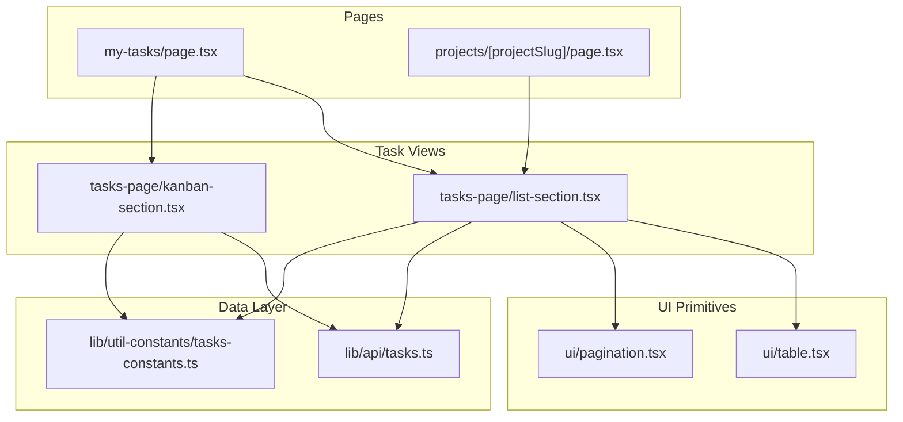
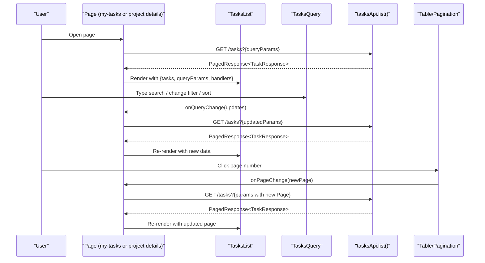
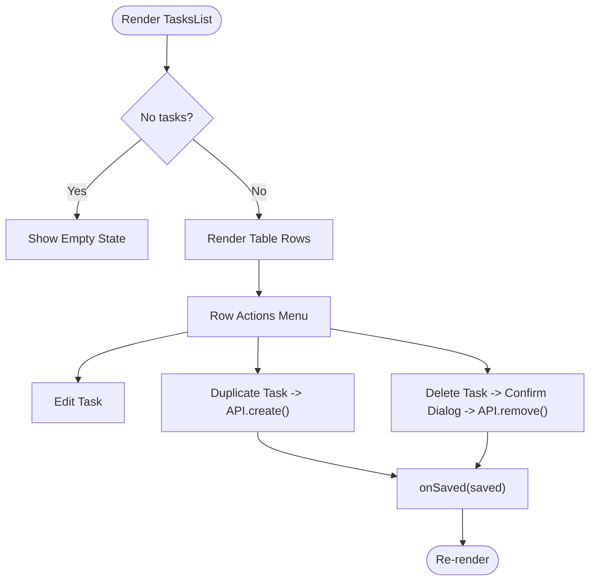
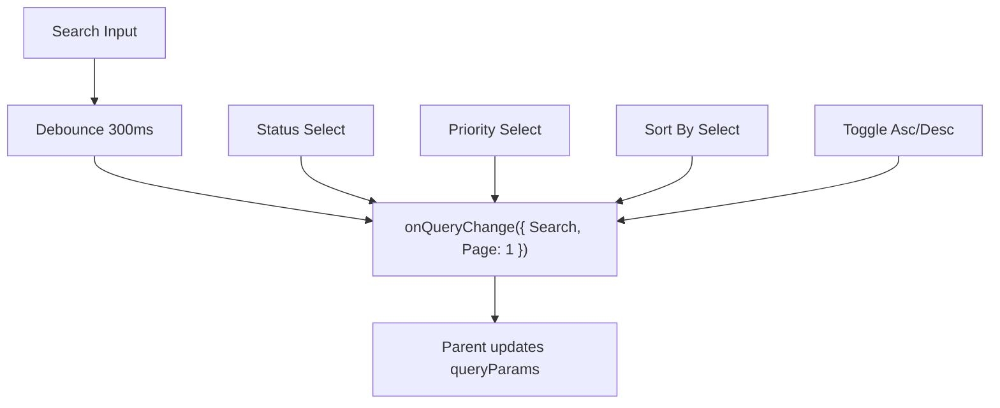
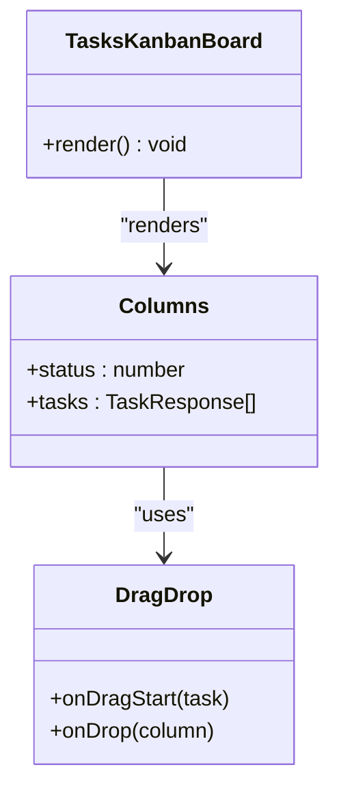
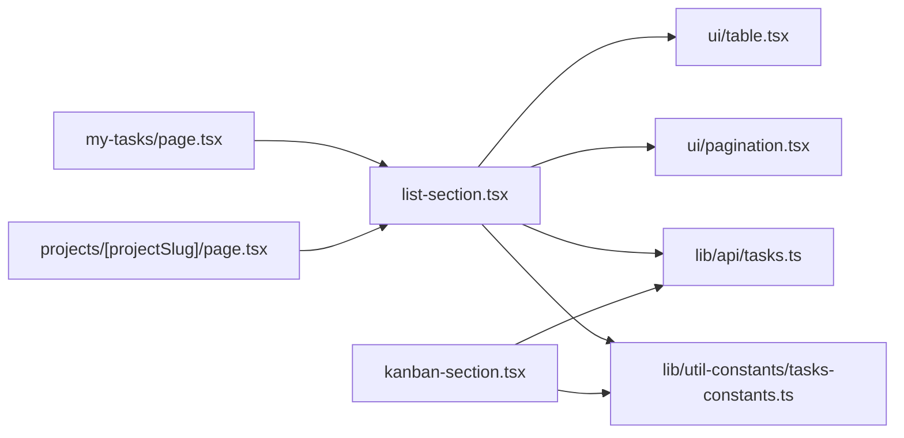

# Task Views and Display

<cite>
**Referenced Files in This Document**
- [list-section.tsx](file://Apps/Web/src/components/tasks-page/list-section.tsx)
- [kanban-section.tsx](file://Apps/Web/src/components/tasks-page/kanban-section.tsx)
- [table.tsx](file://Apps/Web/src/components/ui/table.tsx)
- [pagination.tsx](file://Apps/Web/src/components/ui/pagination.tsx)
- [tasks.ts](file://Apps/Web/src/lib/api/tasks.ts)
- [tasks-constants.ts](file://Apps/Web/src/lib/util-constants/tasks-constants.ts)
- [page.tsx (my-tasks)](file://Apps/Web/src/app/(protected)/my-tasks/page.tsx)
- [page.tsx (project details)](file://Apps/Web/src/app/(protected)/projects/[projectSlug]/page.tsx)
</cite>

## Table of Contents
1. [Introduction](#introduction)
2. [Project Structure](#project-structure)
3. [Core Components](#core-components)
4. [Architecture Overview](#architecture-overview)
5. [Detailed Component Analysis](#detailed-component-analysis)
6. [Dependency Analysis](#dependency-analysis)
7. [Performance Considerations](#performance-considerations)
8. [Troubleshooting Guide](#troubleshooting-guide)
9. [Conclusion](#conclusion)

## Introduction
This document explains the task display views implemented in the application, focusing on:
- List view: a tabular interface with search, filtering by status and priority, sorting, and pagination.
- Kanban board view: a visual task management layout with drag-and-drop between status columns.

It covers component responsibilities, data flows, integration points with state management and API, responsive design considerations, accessibility features, and performance optimizations for large task sets. It also provides guidance for customizing layouts and integrating with task state management.

## Project Structure
The task views are rendered within protected pages that manage query parameters, view mode, and task state. The list view is implemented as a reusable component, while the Kanban view is currently a placeholder awaiting implementation.

**Diagram sources**
- [page.tsx (my-tasks):172-198](file://Apps/Web/src/app/(protected)/my-tasks/page.tsx#L172-L198)
- [page.tsx (project details):297-320](file://Apps/Web/src/app/(protected)/projects/[projectSlug]/page.tsx#L297-L320)
- [list-section.tsx:81-276](file://Apps/Web/src/components/tasks-page/list-section.tsx#L81-L276)
- [kanban-section.tsx:1-4](file://Apps/Web/src/components/tasks-page/kanban-section.tsx#L1-L4)
- [table.tsx:1-89](file://Apps/Web/src/components/ui/table.tsx#L1-L89)
- [pagination.tsx:1-131](file://Apps/Web/src/components/ui/pagination.tsx#L1-L131)
- [tasks.ts:74-132](file://Apps/Web/src/lib/api/tasks.ts#L74-L132)
- [tasks-constants.ts:1-37](file://Apps/Web/src/lib/util-constants/tasks-constants.ts#L1-L37)

**Section sources**
- [page.tsx (my-tasks):1-204](file://Apps/Web/src/app/(protected)/my-tasks/page.tsx#L1-L204)
- [page.tsx (project details):1-327](file://Apps/Web/src/app/(protected)/projects/[projectSlug]/page.tsx#L1-L327)

## Core Components
- TasksList (ListSection): Renders a paginated table of tasks with filters (search, status, priority), sorting controls, row actions (edit, duplicate, delete), and empty/loading states.
- TasksQuery: Search input with debounce, status and priority selectors, sort-by selector, and ascending/descending toggle.
- TasksPagination: Page navigation with ellipsis handling and accessible labels.
- TasksKanbanBoard: Placeholder for a Kanban board view; to be extended with drag-and-drop columns per task status.

Key responsibilities:
- Data fetching and pagination are coordinated by parent pages; components receive props for current page, total pages, and handlers for query changes and page navigation.
- UI primitives (Table, Pagination) provide consistent styling and accessibility.
- Constants map backend enums to user-facing labels and styles.

**Section sources**
- [list-section.tsx:81-276](file://Apps/Web/src/components/tasks-page/list-section.tsx#L81-L276)
- [list-section.tsx:280-455](file://Apps/Web/src/components/tasks-page/list-section.tsx#L280-L455)
- [list-section.tsx:457-549](file://Apps/Web/src/components/tasks-page/list-section.tsx#L457-L549)
- [kanban-section.tsx:1-4](file://Apps/Web/src/components/tasks-page/kanban-section.tsx#L1-L4)
- [table.tsx:1-89](file://Apps/Web/src/components/ui/table.tsx#L1-L89)
- [pagination.tsx:1-131](file://Apps/Web/src/components/ui/pagination.tsx#L1-L131)
- [tasks-constants.ts:1-37](file://Apps/Web/src/lib/util-constants/tasks-constants.ts#L1-L37)

## Architecture Overview
The list view integrates with the API layer to fetch paged task data based on query parameters. Parent pages own the query state and pass it down to the list component. The Kanban view is integrated into the same routing structure but is not yet implemented.

**Diagram sources**
- [page.tsx (my-tasks):68-81](file://Apps/Web/src/app/(protected)/my-tasks/page.tsx#L68-L81)
- [page.tsx (my-tasks):123-130](file://Apps/Web/src/app/(protected)/my-tasks/page.tsx#L123-L130)
- [list-section.tsx:280-455](file://Apps/Web/src/components/tasks-page/list-section.tsx#L280-L455)
- [list-section.tsx:457-549](file://Apps/Web/src/components/tasks-page/list-section.tsx#L457-L549)
- [tasks.ts:94-107](file://Apps/Web/src/lib/api/tasks.ts#L94-L107)

## Detailed Component Analysis

### List Section (TasksList)
- Displays tasks in a table using the shared Table primitive.
- Shows badges for project name, status, and priority using constants for labels and styles.
- Provides row actions via a dropdown menu: edit, duplicate, delete.
- Integrates with a delete confirmation dialog and toast notifications for success/error feedback.
- Delegates query/filtering/sorting to TasksQuery and pagination to TasksPagination.

Responsibilities and behaviors:
- Duplicate task: creates a new task with a copied title suffix and calls the API; updates local state via onSaved.
- Delete task: opens a confirmation dialog, calls the API, and removes the item from local state via onDelete.
- Empty and loading states: renders appropriate placeholders when no tasks are available or while loading.

Accessibility highlights:
- Uses aria-labels on interactive elements like search button and sort toggle.
- Pagination uses semantic roles and aria-current attributes for active page.

Responsive considerations:
- Table rows wrap content appropriately; badges and icons scale with container sizes.
- Pagination hides text labels on small screens and shows only icons.

**Diagram sources**
- [list-section.tsx:103-156](file://Apps/Web/src/components/tasks-page/list-section.tsx#L103-L156)
- [list-section.tsx:196-269](file://Apps/Web/src/components/tasks-page/list-section.tsx#L196-L269)

**Section sources**
- [list-section.tsx:81-276](file://Apps/Web/src/components/tasks-page/list-section.tsx#L81-L276)

### Query Controls (TasksQuery)
- Search input with debounced update to avoid excessive requests.
- Status and Priority selectors bound to query params.
- Sort-by selector and ascending/descending toggle.
- All changes reset to page 1 to reflect filtered results.

**Diagram sources**
- [list-section.tsx:280-455](file://Apps/Web/src/components/tasks-page/list-section.tsx#L280-L455)

**Section sources**
- [list-section.tsx:280-455](file://Apps/Web/src/components/tasks-page/list-section.tsx#L280-L455)

### Pagination (TasksPagination)
- Calculates visible page numbers with ellipsis for large page counts.
- Disables previous/next buttons at boundaries and marks the active page.
- Emits onPageChange to let the parent update query params and refetch data.

**Diagram sources**
- [list-section.tsx:457-549](file://Apps/Web/src/components/tasks-page/list-section.tsx#L457-L549)
- [pagination.tsx:37-64](file://Apps/Web/src/components/ui/pagination.tsx#L37-L64)

**Section sources**
- [list-section.tsx:457-549](file://Apps/Web/src/components/tasks-page/list-section.tsx#L457-L549)
- [pagination.tsx:1-131](file://Apps/Web/src/components/ui/pagination.tsx#L1-L131)

### Kanban Board (TasksKanbanBoard)
- Current implementation is a placeholder returning an empty section.
- Recommended next steps:
  - Define columns per task status using constants.
  - Implement drag-and-drop between columns to update task status via API.
  - Integrate with the same query/state pattern used by the list view.

**Diagram sources**
- [kanban-section.tsx:1-4](file://Apps/Web/src/components/tasks-page/kanban-section.tsx#L1-L4)

**Section sources**
- [kanban-section.tsx:1-4](file://Apps/Web/src/components/tasks-page/kanban-section.tsx#L1-L4)

## Dependency Analysis
- TasksList depends on:
  - Table and Pagination UI primitives for rendering.
  - tasksApi for creating, updating, deleting, and listing tasks.
  - tasks-constants for mapping statuses, priorities, and sort field labels/styles.
- Parent pages manage:
  - View mode switching (kanban vs list).
  - Query parameter state and pagination.
  - Local optimistic updates on save/delete.

**Diagram sources**
- [page.tsx (my-tasks):172-198](file://Apps/Web/src/app/(protected)/my-tasks/page.tsx#L172-L198)
- [page.tsx (project details):297-320](file://Apps/Web/src/app/(protected)/projects/[projectSlug]/page.tsx#L297-L320)
- [list-section.tsx:81-276](file://Apps/Web/src/components/tasks-page/list-section.tsx#L81-L276)
- [kanban-section.tsx:1-4](file://Apps/Web/src/components/tasks-page/kanban-section.tsx#L1-L4)
- [table.tsx:1-89](file://Apps/Web/src/components/ui/table.tsx#L1-L89)
- [pagination.tsx:1-131](file://Apps/Web/src/components/ui/pagination.tsx#L1-L131)
- [tasks.ts:74-132](file://Apps/Web/src/lib/api/tasks.ts#L74-L132)
- [tasks-constants.ts:1-37](file://Apps/Web/src/lib/util-constants/tasks-constants.ts#L1-L37)

**Section sources**
- [page.tsx (my-tasks):1-204](file://Apps/Web/src/app/(protected)/my-tasks/page.tsx#L1-L204)
- [page.tsx (project details):1-327](file://Apps/Web/src/app/(protected)/projects/[projectSlug]/page.tsx#L1-L327)
- [list-section.tsx:81-276](file://Apps/Web/src/components/tasks-page/list-section.tsx#L81-L276)
- [kanban-section.tsx:1-4](file://Apps/Web/src/components/tasks-page/kanban-section.tsx#L1-L4)
- [tasks.ts:74-132](file://Apps/Web/src/lib/api/tasks.ts#L74-L132)
- [tasks-constants.ts:1-37](file://Apps/Web/src/lib/util-constants/tasks-constants.ts#L1-L37)

## Performance Considerations
- Server-side pagination: Use PageSize and Page to limit DOM nodes and network payload.
- Debounced search: Avoid frequent re-renders and API calls during typing.
- Memoization: Consider memoizing derived lists and expensive computations in parent pages.
- Virtualization: For very large datasets, consider virtualized tables to render only visible rows.
- Optimistic updates: Apply immediate UI changes on save/delete and roll back on error.
- Image and icon optimization: Ensure icons and avatars are lightweight and use proper sizing.

[No sources needed since this section provides general guidance]

## Troubleshooting Guide
Common issues and resolutions:
- No tasks displayed:
  - Verify query parameters (status, priority, search) are correct.
  - Check API response and ensure totalCount and totalPages are set.
- Sorting not applied:
  - Confirm SortBy and SortDirection are passed to the API.
- Pagination not working:
  - Ensure onPageChange updates Page and triggers a new fetch.
- Delete/Duplicate errors:
  - Inspect toast messages and ApiError payloads for server-side validation issues.

Integration tips:
- Keep query state centralized in the page component and pass it down to avoid prop drilling inconsistencies.
- Use consistent enum values for status and priority across frontend and backend.

**Section sources**
- [list-section.tsx:103-156](file://Apps/Web/src/components/tasks-page/list-section.tsx#L103-L156)
- [list-section.tsx:280-455](file://Apps/Web/src/components/tasks-page/list-section.tsx#L280-L455)
- [list-section.tsx:457-549](file://Apps/Web/src/components/tasks-page/list-section.tsx#L457-L549)
- [page.tsx (my-tasks):68-81](file://Apps/Web/src/app/(protected)/my-tasks/page.tsx#L68-L81)
- [page.tsx (project details):98-115](file://Apps/Web/src/app/(protected)/projects/[projectSlug]/page.tsx#L98-L115)

## Conclusion
The list view provides a robust, accessible, and responsive interface for managing tasks with search, filtering, sorting, and pagination. The Kanban view is currently a placeholder and should be extended to support drag-and-drop status transitions. Both views integrate cleanly with the API layer and share common constants for labels and styles. Following the recommended patterns will help maintain consistency, performance, and accessibility across the application.

[No sources needed since this section summarizes without analyzing specific files]