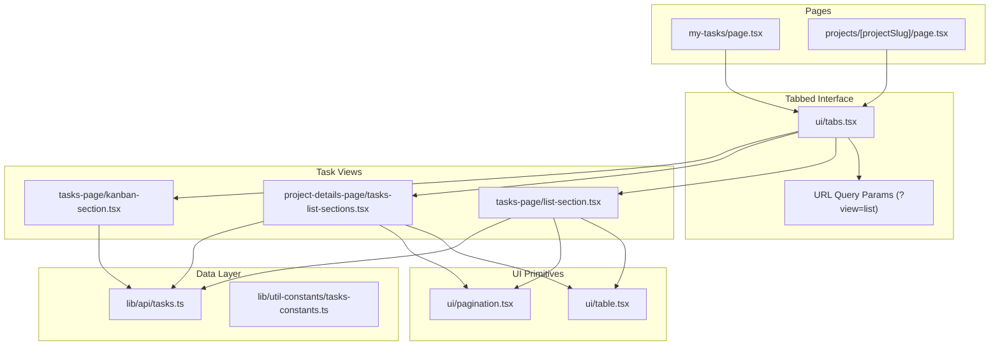
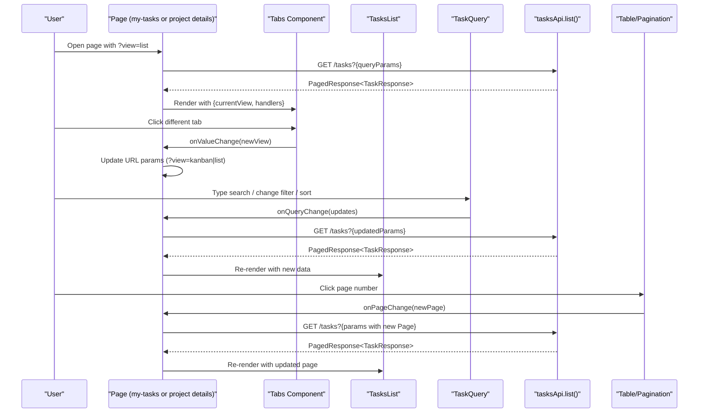
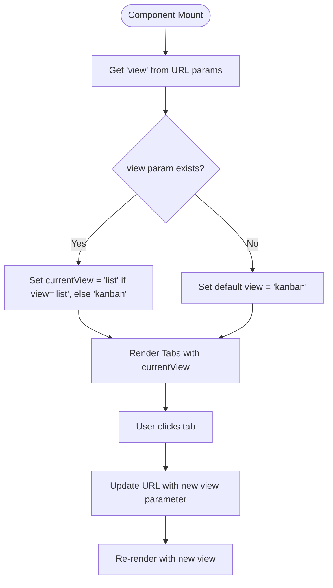
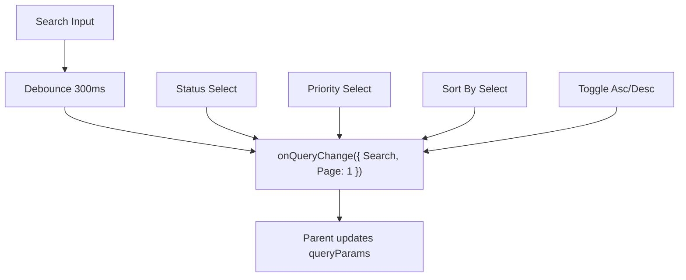
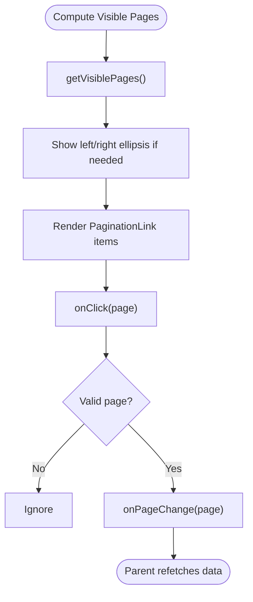
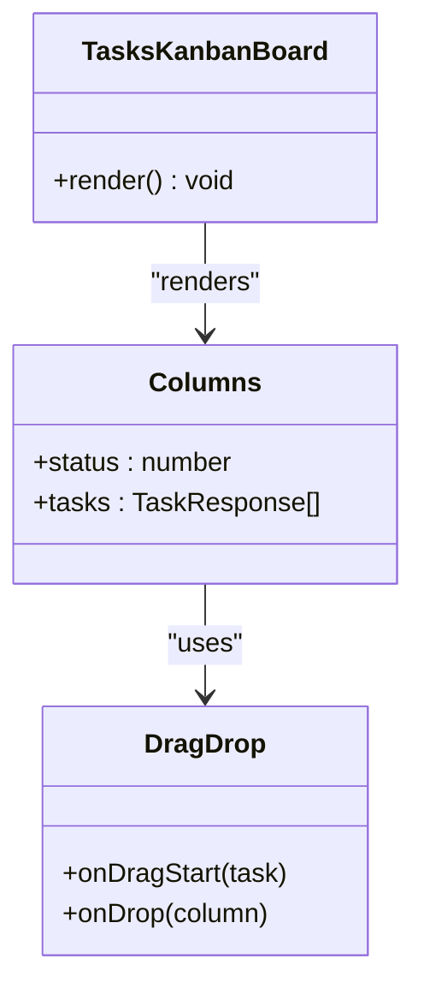
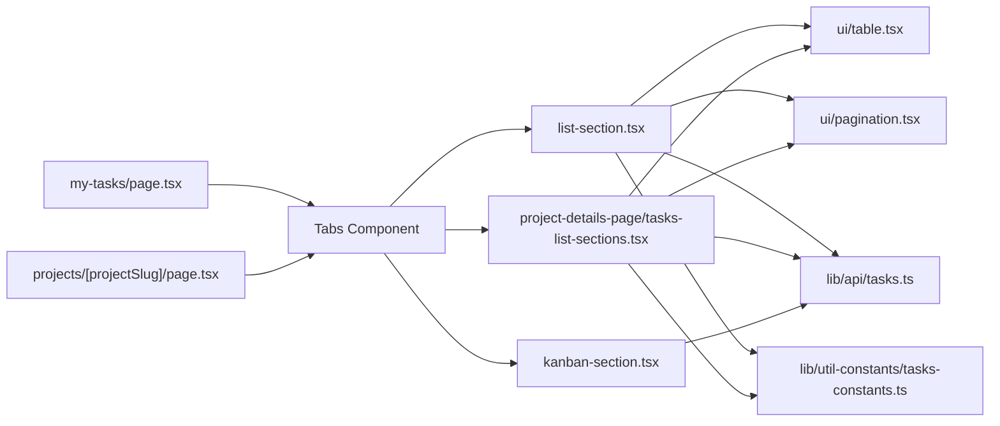

# Task Views and Display

<cite>
**Referenced Files in This Document**
- [page.tsx (my-tasks)](file://Apps/Web/src/app/(protected)/my-tasks/page.tsx)
- [page.tsx (project details)](file://Apps/Web/src/app/(protected)/projects/[projectSlug]/page.tsx)
- [tasks-list-sections.tsx](file://Apps/Web/src/components/project-details-page/tasks-list-sections.tsx)
- [list-section.tsx](file://Apps/Web/src/components/tasks-page/list-section.tsx)
- [kanban-section.tsx](file://Apps/Web/src/components/tasks-page/kanban-section.tsx)
- [tabs.tsx](file://Apps/Web/src/components/ui/tabs.tsx)
- [table.tsx](file://Apps/Web/src/components/ui/table.tsx)
- [pagination.tsx](file://Apps/Web/src/components/ui/pagination.tsx)
- [tasks.ts](file://Apps/Web/src/lib/api/tasks.ts)
- [tasks-constants.ts](file://Apps/Web/src/lib/util-constants/tasks-constants.ts)
</cite>

## Update Summary
**Changes Made**
- Updated to reflect new tabbed interface implementation in both project details and my-tasks pages
- Added documentation for URL-based view state management via query parameters
- Enhanced list view documentation to reflect full functionality integration
- Updated architecture diagrams to show tabbed interface structure
- Added sections covering responsive design considerations and accessibility features

## Table of Contents
1. [Introduction](#introduction)
2. [Project Structure](#project-structure)
3. [Core Components](#core-components)
4. [Architecture Overview](#architecture-overview)
5. [Tabbed Interface Implementation](#tabbed-interface-implementation)
6. [Detailed Component Analysis](#detailed-component-analysis)
7. [Dependency Analysis](#dependency-analysis)
8. [Performance Considerations](#performance-considerations)
9. [Responsive Design and Accessibility](#responsive-design-and-accessibility)
10. [Troubleshooting Guide](#troubleshooting-guide)
11. [Conclusion](#conclusion)

## Introduction
This document explains the task display views implemented in the application, focusing on the new tabbed interface that supports both Kanban and list views with URL-based state management. The implementation includes:

- **Tabbed Interface**: A unified navigation system using tabs to switch between Kanban and list views
- **URL-based View State**: View mode persistence through query parameters (`?view=list` or `?view=kanban`)
- **List View**: A fully functional tabular interface with search, filtering by status and priority, sorting, and pagination
- **Kanban View**: A placeholder component awaiting drag-and-drop implementation

The system provides consistent user experience across project details and my-tasks pages while maintaining separation of concerns and reusability.

## Project Structure
The task views are rendered within protected pages that manage query parameters, view mode, and task state. Both project details and my-tasks pages implement the same tabbed interface pattern.

**Diagram sources**
- [page.tsx (my-tasks):172-198](file://Apps/Web/src/app/(protected)/my-tasks/page.tsx#L172-L198)
- [page.tsx (project details):297-321](file://Apps/Web/src/app/(protected)/projects/[projectSlug]/page.tsx#L297-L321)
- [tabs.tsx:1-82](file://Apps/Web/src/components/ui/tabs.tsx#L1-L82)

**Section sources**
- [page.tsx (my-tasks):1-204](file://Apps/Web/src/app/(protected)/my-tasks/page.tsx#L1-L204)
- [page.tsx (project details):1-327](file://Apps/Web/src/app/(protected)/projects/[projectSlug]/page.tsx#L1-L327)

## Core Components
- **TasksList (ListSection)**: Renders a paginated table of tasks with filters (search, status, priority), sorting controls, row actions (edit, duplicate, delete), and empty/loading states.
- **ProjectTasksList**: Project-specific list implementation that reuses core list functionality with project context.
- **TaskQuery**: Search input with debounce, status and priority selectors, sort-by selector, and ascending/descending toggle.
- **TasksPagination**: Page navigation with ellipsis handling and accessible labels.
- **TasksKanbanBoard**: Placeholder for a Kanban board view; to be extended with drag-and-drop columns per task status.
- **Tabs Interface**: Unified navigation component managing view state and content switching.

Key responsibilities:
- Data fetching and pagination are coordinated by parent pages; components receive props for current page, total pages, and handlers for query changes and page navigation.
- UI primitives (Table, Pagination, Tabs) provide consistent styling and accessibility.
- Constants map backend enums to user-facing labels and styles.

**Section sources**
- [list-section.tsx:81-276](file://Apps/Web/src/components/tasks-page/list-section.tsx#L81-L276)
- [tasks-list-sections.tsx:57-253](file://Apps/Web/src/components/project-details-page/tasks-list-sections.tsx#L57-L253)
- [kanban-section.tsx:1-4](file://Apps/Web/src/components/tasks-page/kanban-section.tsx#L1-L4)
- [tabs.tsx:1-82](file://Apps/Web/src/components/ui/tabs.tsx#L1-L82)

## Architecture Overview
The tabbed interface integrates with the API layer to fetch paged task data based on query parameters. Parent pages own the query state and pass it down to the list component. The Kanban view is integrated into the same routing structure but is not yet implemented.

**Diagram sources**
- [page.tsx (my-tasks):83-88](file://Apps/Web/src/app/(protected)/my-tasks/page.tsx#L83-L88)
- [page.tsx (project details):117-122](file://Apps/Web/src/app/(protected)/projects/[projectSlug]/page.tsx#L117-L122)
- [list-section.tsx:280-455](file://Apps/Web/src/components/tasks-page/list-section.tsx#L280-L455)

## Tabbed Interface Implementation

### View State Management
The tabbed interface uses Next.js router and search parameters to maintain view state in the URL. This enables bookmarking, sharing, and browser history support.

**Diagram sources**
- [page.tsx (my-tasks):44-45](file://Apps/Web/src/app/(protected)/my-tasks/page.tsx#L44-L45)
- [page.tsx (project details):51-52](file://Apps/Web/src/app/(protected)/projects/[projectSlug]/page.tsx#L51-L52)

### Tab Navigation
Both pages implement identical tab navigation patterns with Kanban and List options, providing consistent user experience across the application.

**Section sources**
- [page.tsx (my-tasks):172-198](file://Apps/Web/src/app/(protected)/my-tasks/page.tsx#L172-L198)
- [page.tsx (project details):297-321](file://Apps/Web/src/app/(protected)/projects/[projectSlug]/page.tsx#L297-L321)

## Detailed Component Analysis

### List Section (TasksList)
- Displays tasks in a table using the shared Table primitive.
- Shows badges for project name, status, and priority using constants for labels and styles.
- Provides row actions via a dropdown menu: edit, duplicate, delete.
- Integrates with a delete confirmation dialog and toast notifications for success/error feedback.
- Delegates query/filtering/sorting to TaskQuery and pagination to TasksPagination.

Responsibilities and behaviors:
- Duplicate task: creates a new task with a copied title suffix and calls the API; updates local state via onSaved.
- Delete task: opens a confirmation dialog, calls the API, and removes the item from local state via onDelete.
- Empty and loading states: renders appropriate placeholders when no tasks are available or while loading.

Accessibility highlights:
- Uses aria-labels on interactive elements like search button and sort toggle.
- Pagination uses semantic roles and aria-current attributes for active page.

Responsive considerations:
- Table rows wrap content appropriately; badges and icons scale with container sizes.
- Pagination hides text labels on small screens and shows only icons.

**Diagram sources**
- [list-section.tsx:103-156](file://Apps/Web/src/components/tasks-page/list-section.tsx#L103-L156)
- [list-section.tsx:196-269](file://Apps/Web/src/components/tasks-page/list-section.tsx#L196-L269)

**Section sources**
- [list-section.tsx:81-276](file://Apps/Web/src/components/tasks-page/list-section.tsx#L81-L276)

### Project-Specific List (ProjectTasksList)
A specialized implementation for project details that reuses core list functionality while providing project-specific context and styling.

Key differences from generic TasksList:
- Uses project-specific color coding for project badges
- Simplified column layout optimized for project context
- Reuses TaskQuery and TasksPagination components

**Section sources**
- [tasks-list-sections.tsx:57-253](file://Apps/Web/src/components/project-details-page/tasks-list-sections.tsx#L57-L253)

### Query Controls (TaskQuery)
- Search input with debounced update to avoid excessive requests.
- Status and Priority selectors bound to query params.
- Sort-by selector and ascending/descending toggle.
- All changes reset to page 1 to reflect filtered results.

**Diagram sources**
- [list-section.tsx:280-455](file://Apps/Web/src/components/tasks-page/list-section.tsx#L280-L455)

**Section sources**
- [list-section.tsx:280-455](file://Apps/Web/src/components/tasks-page/list-section.tsx#L280-L455)

### Pagination (TasksPagination)
- Calculates visible page numbers with ellipsis for large page counts.
- Disables previous/next buttons at boundaries and marks the active page.
- Emits onPageChange to let the parent update query params and refetch data.

**Diagram sources**
- [list-section.tsx:457-549](file://Apps/Web/src/components/tasks-page/list-section.tsx#L457-L549)

**Section sources**
- [list-section.tsx:457-549](file://Apps/Web/src/components/tasks-page/list-section.tsx#L457-L549)

### Kanban Board (TasksKanbanBoard)
- Current implementation is a placeholder returning an empty section.
- Recommended next steps:
  - Define columns per task status using constants.
  - Implement drag-and-drop between columns to update task status via API.
  - Integrate with the same query/state pattern used by the list view.

**Diagram sources**
- [kanban-section.tsx:1-4](file://Apps/Web/src/components/tasks-page/kanban-section.tsx#L1-L4)

**Section sources**
- [kanban-section.tsx:1-4](file://Apps/Web/src/components/tasks-page/kanban-section.tsx#L1-L4)

## Dependency Analysis
- TasksList depends on:
  - Table and Pagination UI primitives for rendering.
  - tasksApi for creating, updating, deleting, and listing tasks.
  - tasks-constants for mapping statuses, priorities, and sort field labels/styles.
- Parent pages manage:
  - View mode switching (kanban vs list).
  - Query parameter state and pagination.
  - Local optimistic updates on save/delete.

**Diagram sources**
- [page.tsx (my-tasks):172-198](file://Apps/Web/src/app/(protected)/my-tasks/page.tsx#L172-L198)
- [page.tsx (project details):297-321](file://Apps/Web/src/app/(protected)/projects/[projectSlug]/page.tsx#L297-L321)

**Section sources**
- [page.tsx (my-tasks):1-204](file://Apps/Web/src/app/(protected)/my-tasks/page.tsx#L1-L204)
- [page.tsx (project details):1-327](file://Apps/Web/src/app/(protected)/projects/[projectSlug]/page.tsx#L1-L327)

## Performance Considerations
- Server-side pagination: Use PageSize and Page to limit DOM nodes and network payload.
- Debounced search: Avoid frequent re-renders and API calls during typing.
- Memoization: Consider memoizing derived lists and expensive computations in parent pages.
- Virtualization: For very large datasets, consider virtualized tables to render only visible rows.
- Optimistic updates: Apply immediate UI changes on save/delete and roll back on error.
- Image and icon optimization: Ensure icons and avatars are lightweight and use proper sizing.
- Tab switching: Minimize re-renders when switching between tabs by leveraging React's component lifecycle.

## Responsive Design and Accessibility

### Responsive Design
- **Mobile-first approach**: Components are designed to work well on mobile devices with touch interactions.
- **Adaptive layouts**: Tables and forms adapt to screen size constraints.
- **Touch-friendly interfaces**: Larger tap targets and swipe gestures where applicable.
- **Progressive enhancement**: Core functionality works without JavaScript, enhanced with client-side features.

### Accessibility Features
- **Semantic HTML**: Proper use of heading levels, landmarks, and semantic elements.
- **Keyboard navigation**: Full keyboard support for all interactive elements.
- **Screen reader support**: ARIA labels, roles, and live regions for dynamic content.
- **Color contrast**: WCAG-compliant color combinations for readability.
- **Focus management**: Logical focus order and visible focus indicators.

### Tabbed Interface Accessibility
- **ARIA roles**: Proper ARIA roles for tabs, tab panels, and navigation.
- **Keyboard shortcuts**: Arrow keys for tab navigation, Enter/Space for activation.
- **Screen reader announcements**: Dynamic content changes announced to assistive technologies.
- **Focus trapping**: Focus management within tab panels.

**Section sources**
- [tabs.tsx:55-68](file://Apps/Web/src/components/ui/tabs.tsx#L55-L68)

## Troubleshooting Guide
Common issues and resolutions:
- **No tasks displayed**:
  - Verify query parameters (status, priority, search) are correct.
  - Check API response and ensure totalCount and totalPages are set.
- **Sorting not applied**:
  - Confirm SortBy and SortDirection are passed to the API.
- **Pagination not working**:
  - Ensure onPageChange updates Page and triggers a new fetch.
- **Delete/Duplicate errors**:
  - Inspect toast messages and ApiError payloads for server-side validation issues.
- **Tab switching issues**:
  - Verify URL query parameters are being updated correctly.
  - Check that currentView state matches the URL parameter.

Integration tips:
- Keep query state centralized in the page component and pass it down to avoid prop drilling inconsistencies.
- Use consistent enum values for status and priority across frontend and backend.
- Ensure tab state synchronization between URL and component state.

**Section sources**
- [list-section.tsx:103-156](file://Apps/Web/src/components/tasks-page/list-section.tsx#L103-L156)
- [list-section.tsx:280-455](file://Apps/Web/src/components/tasks-page/list-section.tsx#L280-L455)
- [list-section.tsx:457-549](file://Apps/Web/src/components/tasks-page/list-section.tsx#L457-L549)
- [page.tsx (my-tasks):83-88](file://Apps/Web/src/app/(protected)/my-tasks/page.tsx#L83-L88)
- [page.tsx (project details):117-122](file://Apps/Web/src/app/(protected)/projects/[projectSlug]/page.tsx#L117-L122)

## Conclusion
The tabbed interface provides a robust, accessible, and responsive solution for managing task views with search, filtering, sorting, and pagination capabilities. The URL-based state management ensures consistent user experience across navigation and sharing scenarios. The list view offers full functionality while the Kanban view serves as a foundation for future drag-and-drop enhancements. Both views integrate cleanly with the API layer and share common constants for labels and styles. Following the recommended patterns will help maintain consistency, performance, and accessibility across the application.