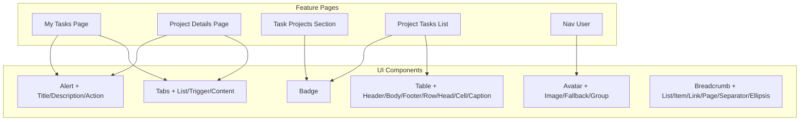
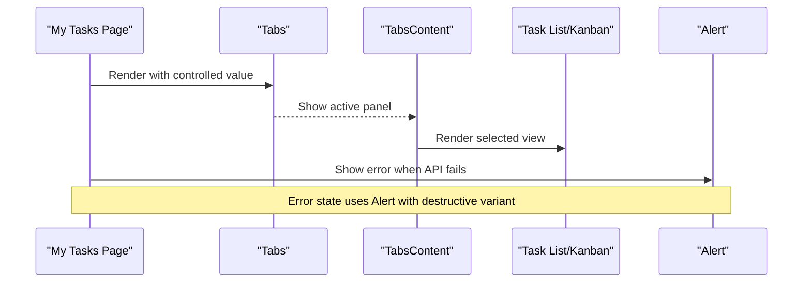
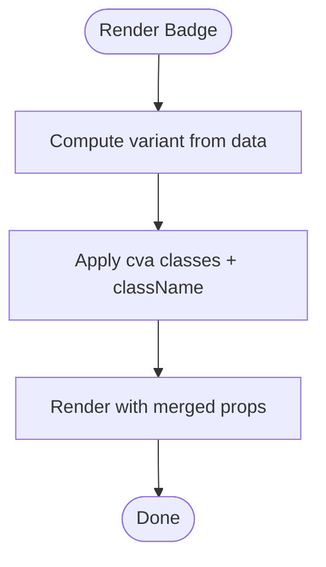
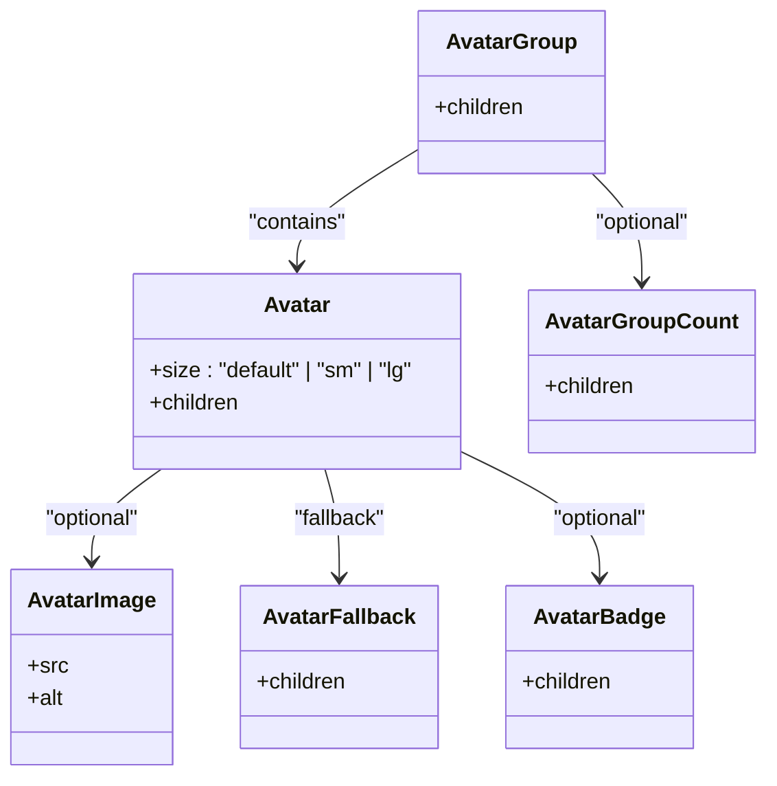
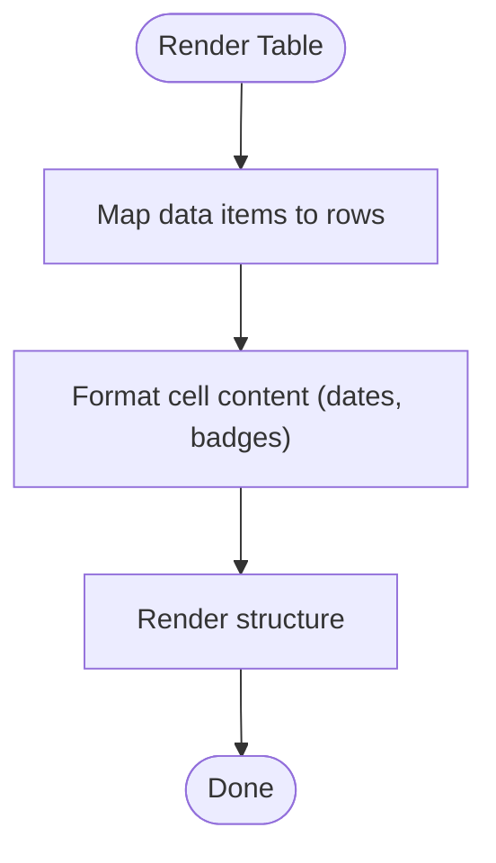
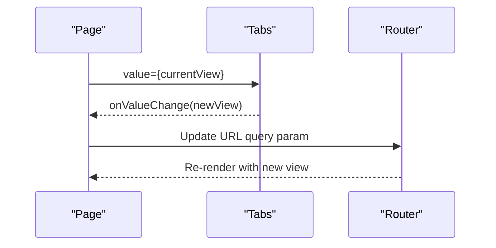
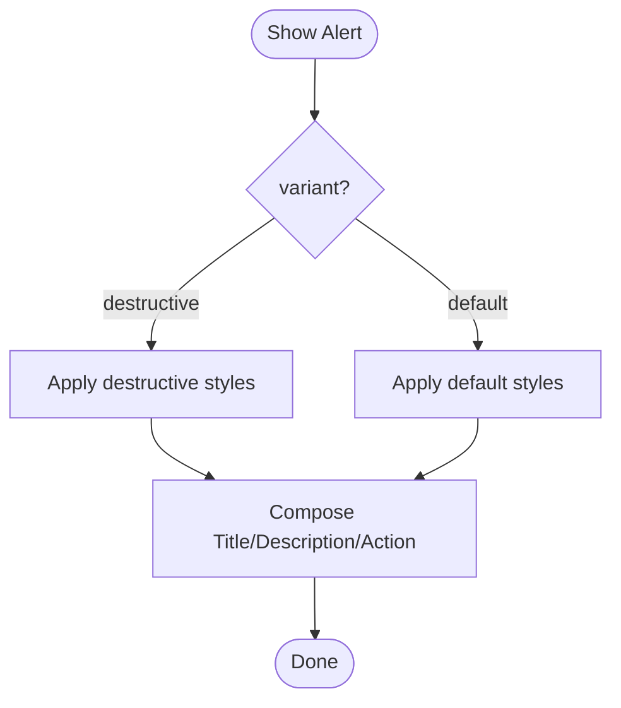
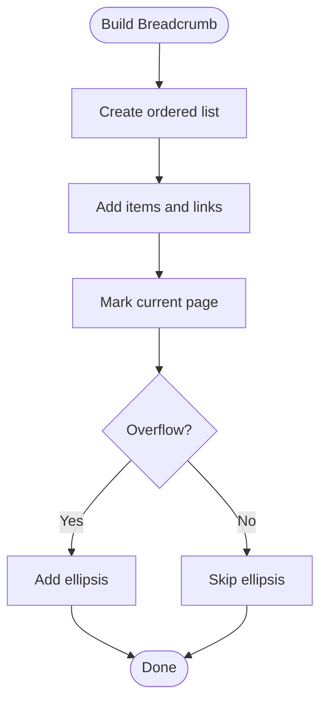
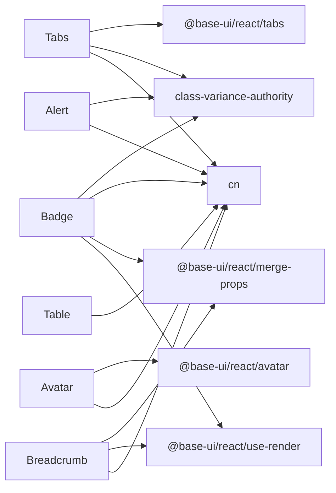

# Display Components

<cite>
**Referenced Files in This Document**
- [badge.tsx](file://Apps/Web/src/components/ui/badge.tsx)
- [avatar.tsx](file://Apps/Web/src/components/ui/avatar.tsx)
- [table.tsx](file://Apps/Web/src/components/ui/table.tsx)
- [tabs.tsx](file://Apps/Web/src/components/ui/tabs.tsx)
- [alert.tsx](file://Apps/Web/src/components/ui/alert.tsx)
- [breadcrumb.tsx](file://Apps/Web/src/components/ui/breadcrumb.tsx)
- [tasks-projects-section.tsx](file://Apps/Web/src/components/main-page/tasks-projects-section.tsx)
- [tasks-list-sections.tsx](file://Apps/Web/src/components/project-details-page/tasks-list-sections.tsx)
- [my-tasks page.tsx](file://Apps/Web/src/app/(protected)/my-tasks/page.tsx)
- [project details page.tsx](file://Apps/Web/src/app/(protected)/projects/[projectSlug]/page.tsx)
- [nav-user.tsx](file://Apps/Web/src/components/nav-user.tsx)
</cite>

## Table of Contents
1. Introduction
2. Project Structure
3. Core Components
4. Architecture Overview
5. Detailed Component Analysis
6. Dependency Analysis
7. Performance Considerations
8. Troubleshooting Guide
9. Conclusion

## Introduction
This document explains the display and presentation UI components used across the application: Badge, Avatar, Table, Tabs, Alert, and Breadcrumb. It covers component props, data binding patterns, rendering optimizations, styling customization, responsive behavior, accessibility features, internationalization support, and performance considerations for large datasets. Examples demonstrate structured data display, tabbed interfaces, and navigational elements.

## Project Structure
The display components are implemented as small, focused React components under src/components/ui. They are consumed by feature pages and sections to render structured content and navigation.

**Diagram sources**
- [tabs.tsx:7-81](file://Apps/Web/src/components/ui/tabs.tsx#L7-L81)
- [alert.tsx:21-75](file://Apps/Web/src/components/ui/alert.tsx#L21-L75)
- [badge.tsx:26-48](file://Apps/Web/src/components/ui/badge.tsx#L26-L48)
- [table.tsx:6-88](file://Apps/Web/src/components/ui/table.tsx#L6-L88)
- [breadcrumb.tsx:8-103](file://Apps/Web/src/components/ui/breadcrumb.tsx#L8-L103)
- [avatar.tsx:7-92](file://Apps/Web/src/components/ui/avatar.tsx#L7-L92)
- [my-tasks page.tsx:172-198](file://Apps/Web/src/app/(protected)/my-tasks/page.tsx#L172-L198)
- [project details page.tsx:297-321](file://Apps/Web/src/app/(protected)/projects/[projectSlug]/page.tsx#L297-L321)
- [tasks-projects-section.tsx:66-81](file://Apps/Web/src/components/main-page/tasks-projects-section.tsx#L66-L81)
- [tasks-list-sections.tsx:172-245](file://Apps/Web/src/components/project-details-page/tasks-list-sections.tsx#L172-L245)
- [nav-user.tsx:52-54](file://Apps/Web/src/components/nav-user.tsx#L52-L54)

**Section sources**
- [tabs.tsx:7-81](file://Apps/Web/src/components/ui/tabs.tsx#L7-L81)
- [alert.tsx:21-75](file://Apps/Web/src/components/ui/alert.tsx#L21-L75)
- [badge.tsx:26-48](file://Apps/Web/src/components/ui/badge.tsx#L26-L48)
- [table.tsx:6-88](file://Apps/Web/src/components/ui/table.tsx#L6-L88)
- [breadcrumb.tsx:8-103](file://Apps/Web/src/components/ui/breadcrumb.tsx#L8-L103)
- [avatar.tsx:7-92](file://Apps/Web/src/components/ui/avatar.tsx#L7-L92)
- [my-tasks page.tsx:172-198](file://Apps/Web/src/app/(protected)/my-tasks/page.tsx#L172-L198)
- [project details page.tsx:297-321](file://Apps/Web/src/app/(protected)/projects/[projectSlug]/page.tsx#L297-L321)
- [tasks-projects-section.tsx:66-81](file://Apps/Web/src/components/main-page/tasks-projects-section.tsx#L66-L81)
- [tasks-list-sections.tsx:172-245](file://Apps/Web/src/components/project-details-page/tasks-list-sections.tsx#L172-L245)
- [nav-user.tsx:52-54](file://Apps/Web/src/components/nav-user.tsx#L52-L54)

## Core Components
This section summarizes each component’s purpose, key props, variants, and usage patterns.

- Badge
  - Purpose: Small status or category labels with variant-based styling.
  - Key props: className, variant (default, secondary, destructive, outline, ghost, link), render function via useRender.
  - Data binding: Typically bound to enum-like values (e.g., status, priority) mapped to styles and labels.
  - Styling: Uses class-variance-authority; supports focus-visible and aria-invalid states.
  - Accessibility: Semantic span; can be combined with icons; ensure meaningful text.

- Avatar
  - Purpose: User identity representation with image, fallback, badge, and grouping.
  - Key props: size ("default", "sm", "lg"), className, plus children AvatarImage/AvatarFallback/AvatarBadge.
  - Data binding: Bind user name/email to initials fallback; bind avatar URL to AvatarImage.
  - Styling: Responsive sizes via data-size attributes; ring and blend modes for dark themes.
  - Accessibility: Grouping semantics; ensure alt text on images.

- Table
  - Purpose: Structured data grid with header/body/footer/row/head/cell/caption.
  - Key props: Standard HTML table element props; container enables horizontal scrolling.
  - Data binding: Map arrays of records to rows; use cells for formatted values.
  - Styling: Hover and selected row states; caption for descriptions.
  - Accessibility: Use proper semantic elements; add captions and headers.

- Tabs
  - Purpose: Tabbed interface to switch between views or panels.
  - Key props: orientation ("horizontal", "vertical"), variant for list style, value/onValueChange for controlled state.
  - Data binding: Controlled by parent state; sync with URL query parameters for persistence.
  - Styling: Variants default/line; active indicator animation.
  - Accessibility: Base primitives manage focus and keyboard navigation.

- Alert
  - Purpose: Contextual feedback messages (info, success, destructive).
  - Key props: variant (default, destructive), children AlertTitle/AlertDescription/AlertAction.
  - Data binding: Bind error messages or system notifications.
  - Styling: Grid layout with optional icon; action area positioned absolutely.
  - Accessibility: role="alert"; screen readers announce changes.

- Breadcrumb
  - Purpose: Hierarchical navigation path.
  - Key props: Children BreadcrumbList/BreadcrumbItem/BreadcrumbLink/BreadcrumbPage/BreadcrumbSeparator/BreadcrumbEllipsis.
  - Data binding: Build from route segments or navigation state.
  - Styling: Flex-wrap layout; ellipsis for overflow.
  - Accessibility: aria-label="breadcrumb"; current page marked with aria-current="page".

**Section sources**
- [badge.tsx:6-48](file://Apps/Web/src/components/ui/badge.tsx#L6-L48)
- [avatar.tsx:7-92](file://Apps/Web/src/components/ui/avatar.tsx#L7-L92)
- [table.tsx:6-88](file://Apps/Web/src/components/ui/table.tsx#L6-L88)
- [tabs.tsx:7-81](file://Apps/Web/src/components/ui/tabs.tsx#L7-L81)
- [alert.tsx:5-75](file://Apps/Web/src/components/ui/alert.tsx#L5-L75)
- [breadcrumb.tsx:8-103](file://Apps/Web/src/components/ui/breadcrumb.tsx#L8-L103)

## Architecture Overview
Display components are composed into higher-level pages and sections. The following diagram maps how pages consume these components to render structured data and navigation.

**Diagram sources**
- [my-tasks page.tsx:172-198](file://Apps/Web/src/app/(protected)/my-tasks/page.tsx#L172-L198)
- [my-tasks page.tsx:153-158](file://Apps/Web/src/app/(protected)/my-tasks/page.tsx#L153-L158)

**Section sources**
- [my-tasks page.tsx:172-198](file://Apps/Web/src/app/(protected)/my-tasks/page.tsx#L172-L198)
- [my-tasks page.tsx:153-158](file://Apps/Web/src/app/(protected)/my-tasks/page.tsx#L153-L158)

## Detailed Component Analysis

### Badge
- Props and variants
  - Supports multiple visual variants for status/priority labeling.
  - Accepts className and a render function through useRender for flexible composition.
- Data binding patterns
  - Commonly bound to task status and priority enums; map to label strings and CSS classes.
- Rendering optimizations
  - Lightweight span wrapper; minimal DOM overhead.
  - Avoid unnecessary re-renders by memoizing computed styles/labels where possible.
- Styling customization
  - Variant-driven styles via cva; extendable with additional variants.
  - Focus-visible and aria-invalid states included for accessibility.
- Example usage
  - Recent tasks list shows status badges per item.
  - Project tasks table displays project, status, and priority badges within cells.

**Diagram sources**
- [badge.tsx:6-48](file://Apps/Web/src/components/ui/badge.tsx#L6-L48)

**Section sources**
- [badge.tsx:6-48](file://Apps/Web/src/components/ui/badge.tsx#L6-L48)
- [tasks-projects-section.tsx:66-81](file://Apps/Web/src/components/main-page/tasks-projects-section.tsx#L66-L81)
- [tasks-list-sections.tsx:188-211](file://Apps/Web/src/components/project-details-page/tasks-list-sections.tsx#L188-L211)

### Avatar
- Props and composition
  - Root accepts size prop; composes AvatarImage, AvatarFallback, AvatarBadge, AvatarGroup, AvatarGroupCount.
- Data binding patterns
  - Derive initials from user name for fallback; bind avatar URL to image source.
- Rendering optimizations
  - Fallback ensures quick render without network dependency.
  - Grouped avatars use negative spacing for compact display.
- Styling customization
  - Size variants scale via data-size attributes; ring and blend modes adapt to theme.
- Example usage
  - Sidebar user menu renders Avatar with fallback initials.

**Diagram sources**
- [avatar.tsx:7-92](file://Apps/Web/src/components/ui/avatar.tsx#L7-L92)

**Section sources**
- [avatar.tsx:7-92](file://Apps/Web/src/components/ui/avatar.tsx#L7-L92)
- [nav-user.tsx:52-54](file://Apps/Web/src/components/nav-user.tsx#L52-L54)

### Table
- Props and structure
  - Provides Table, TableHeader, TableBody, TableFooter, TableRow, TableHead, TableCell, TableCaption.
  - Container div enables horizontal scroll on small screens.
- Data binding patterns
  - Map array of records to rows; format dates and statuses using helpers.
- Rendering optimizations
  - Keep rows lightweight; avoid heavy computations inside cell renderers.
  - For large datasets, consider virtualization at the consumer layer.
- Styling customization
  - Hover and selected row states; caption for accessibility.
- Example usage
  - Project tasks list renders structured data with actions and badges.

**Diagram sources**
- [table.tsx:6-88](file://Apps/Web/src/components/ui/table.tsx#L6-L88)
- [tasks-list-sections.tsx:172-245](file://Apps/Web/src/components/project-details-page/tasks-list-sections.tsx#L172-L245)

**Section sources**
- [table.tsx:6-88](file://Apps/Web/src/components/ui/table.tsx#L6-L88)
- [tasks-list-sections.tsx:172-245](file://Apps/Web/src/components/project-details-page/tasks-list-sections.tsx#L172-L245)

### Tabs
- Props and control flow
  - Controlled by value/onValueChange; supports orientation and list variant.
- Data binding patterns
  - Sync with URL query parameter to persist view selection.
- Rendering optimizations
  - Only render active panel content; defer non-active panels if needed.
- Styling customization
  - Default and line variants; active indicator animations.
- Example usage
  - My Tasks and Project Details pages switch between Kanban and List views.

**Diagram sources**
- [my-tasks page.tsx:83-88](file://Apps/Web/src/app/(protected)/my-tasks/page.tsx#L83-L88)
- [my-tasks page.tsx:172-198](file://Apps/Web/src/app/(protected)/my-tasks/page.tsx#L172-L198)
- [project details page.tsx:117-122](file://Apps/Web/src/app/(protected)/projects/[projectSlug]/page.tsx#L117-L122)
- [project details page.tsx:297-321](file://Apps/Web/src/app/(protected)/projects/[projectSlug]/page.tsx#L297-L321)

**Section sources**
- [tabs.tsx:7-81](file://Apps/Web/src/components/ui/tabs.tsx#L7-L81)
- [my-tasks page.tsx:83-88](file://Apps/Web/src/app/(protected)/my-tasks/page.tsx#L83-L88)
- [my-tasks page.tsx:172-198](file://Apps/Web/src/app/(protected)/my-tasks/page.tsx#L172-L198)
- [project details page.tsx:117-122](file://Apps/Web/src/app/(protected)/projects/[projectSlug]/page.tsx#L117-L122)
- [project details page.tsx:297-321](file://Apps/Web/src/app/(protected)/projects/[projectSlug]/page.tsx#L297-L321)

### Alert
- Props and composition
  - Variants: default, destructive; compose with AlertTitle, AlertDescription, AlertAction.
- Data binding patterns
  - Bind error messages from API calls; show contextual feedback.
- Rendering optimizations
  - Minimal DOM; grid layout adapts to presence of icon and action.
- Styling customization
  - Destructive variant emphasizes error state; action area positioned absolutely.
- Example usage
  - My Tasks page shows error alert when loading tasks fails.

**Diagram sources**
- [alert.tsx:5-75](file://Apps/Web/src/components/ui/alert.tsx#L5-L75)
- [my-tasks page.tsx:153-158](file://Apps/Web/src/app/(protected)/my-tasks/page.tsx#L153-L158)

**Section sources**
- [alert.tsx:5-75](file://Apps/Web/src/components/ui/alert.tsx#L5-L75)
- [my-tasks page.tsx:153-158](file://Apps/Web/src/app/(protected)/my-tasks/page.tsx#L153-L158)

### Breadcrumb
- Props and composition
  - Compose BreadcrumbList, BreadcrumbItem, BreadcrumbLink, BreadcrumbPage, BreadcrumbSeparator, BreadcrumbEllipsis.
- Data binding patterns
  - Build from route segments or navigation state; mark current page.
- Rendering optimizations
  - Lightweight flex layout; ellipsis hides overflow gracefully.
- Styling customization
  - Wrap-break-word for long paths; consistent separator and ellipsis icons.
- Accessibility
  - aria-label="breadcrumb"; current page has aria-current="page".

**Diagram sources**
- [breadcrumb.tsx:8-103](file://Apps/Web/src/components/ui/breadcrumb.tsx#L8-L103)

**Section sources**
- [breadcrumb.tsx:8-103](file://Apps/Web/src/components/ui/breadcrumb.tsx#L8-L103)

## Dependency Analysis
Display components depend on utility libraries for styling and base primitives for interaction.

**Diagram sources**
- [badge.tsx:1-4](file://Apps/Web/src/components/ui/badge.tsx#L1-L4)
- [avatar.tsx:3-5](file://Apps/Web/src/components/ui/avatar.tsx#L3-L5)
- [tabs.tsx:3-5](file://Apps/Web/src/components/ui/tabs.tsx#L3-L5)
- [alert.tsx:2-3](file://Apps/Web/src/components/ui/alert.tsx#L2-L3)
- [table.tsx:3-4](file://Apps/Web/src/components/ui/table.tsx#L3-L4)
- [breadcrumb.tsx:2-4](file://Apps/Web/src/components/ui/breadcrumb.tsx#L2-L4)

**Section sources**
- [badge.tsx:1-4](file://Apps/Web/src/components/ui/badge.tsx#L1-L4)
- [avatar.tsx:3-5](file://Apps/Web/src/components/ui/avatar.tsx#L3-L5)
- [tabs.tsx:3-5](file://Apps/Web/src/components/ui/tabs.tsx#L3-L5)
- [alert.tsx:2-3](file://Apps/Web/src/components/ui/alert.tsx#L2-L3)
- [table.tsx:3-4](file://Apps/Web/src/components/ui/table.tsx#L3-L4)
- [breadcrumb.tsx:2-4](file://Apps/Web/src/components/ui/breadcrumb.tsx#L2-L4)

## Performance Considerations
- Large tables
  - Use pagination and server-side filtering/sorting to limit DOM nodes.
  - Avoid heavy computations inside cell renderers; precompute labels/styles.
  - Consider virtualization libraries for very large datasets.
- Tabs
  - Render only the active panel initially; lazy-load heavy content in inactive panels.
  - Debounce input filters that trigger re-renders.
- Badges and Avatars
  - Memoize computed styles and initials to prevent unnecessary re-renders.
  - Use placeholder fallbacks for avatars to improve perceived performance.
- Alerts
  - Keep alerts minimal; avoid frequent updates that cause layout thrashing.

[No sources needed since this section provides general guidance]

## Troubleshooting Guide
- Tabs not switching
  - Ensure value and onValueChange are properly wired and synchronized with URL query parameters.
  - Verify that the router update does not cause unexpected re-renders.
- Table empty or slow
  - Confirm data is paginated; check that pageSize and page are correct.
  - Validate that cell formatting functions are efficient and not blocking.
- Alert not showing
  - Check error state propagation from API calls; ensure variant is set appropriately.
- Avatar fallback not displaying
  - Ensure fallback content is provided when image fails to load.
- Breadcrumb accessibility issues
  - Verify aria-label on root nav and aria-current on current page.

**Section sources**
- [my-tasks page.tsx:83-88](file://Apps/Web/src/app/(protected)/my-tasks/page.tsx#L83-L88)
- [my-tasks page.tsx:153-158](file://Apps/Web/src/app/(protected)/my-tasks/page.tsx#L153-L158)
- [tasks-list-sections.tsx:172-245](file://Apps/Web/src/components/project-details-page/tasks-list-sections.tsx#L172-L245)
- [avatar.tsx:37-47](file://Apps/Web/src/components/ui/avatar.tsx#L37-L47)
- [breadcrumb.tsx:8-103](file://Apps/Web/src/components/ui/breadcrumb.tsx#L8-L103)

## Conclusion
The display components provide a cohesive, accessible, and customizable foundation for presenting structured data and navigation. By leveraging variants, controlled state, and semantic markup, they support responsive design, internationalization, and performance best practices. Integrate them thoughtfully to build scalable and user-friendly interfaces.

[No sources needed since this section summarizes without analyzing specific files]