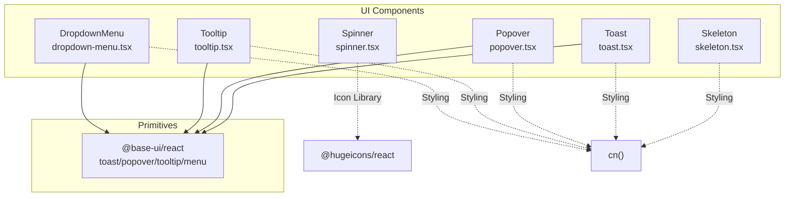
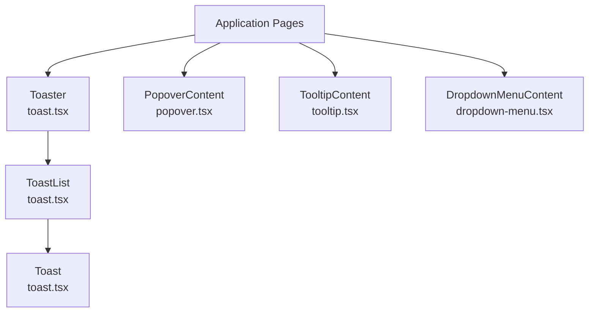
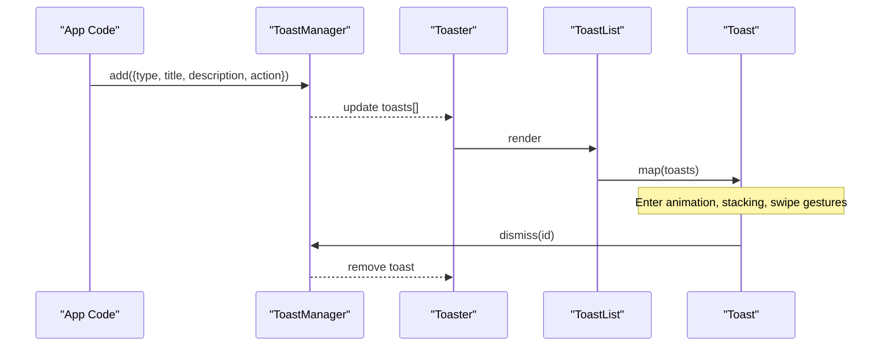
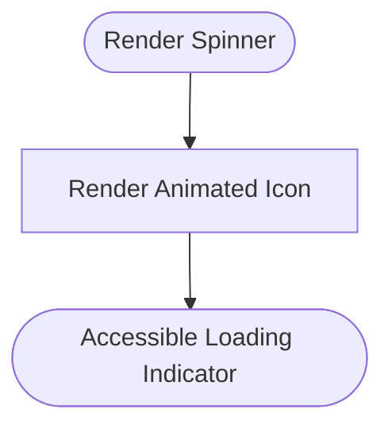
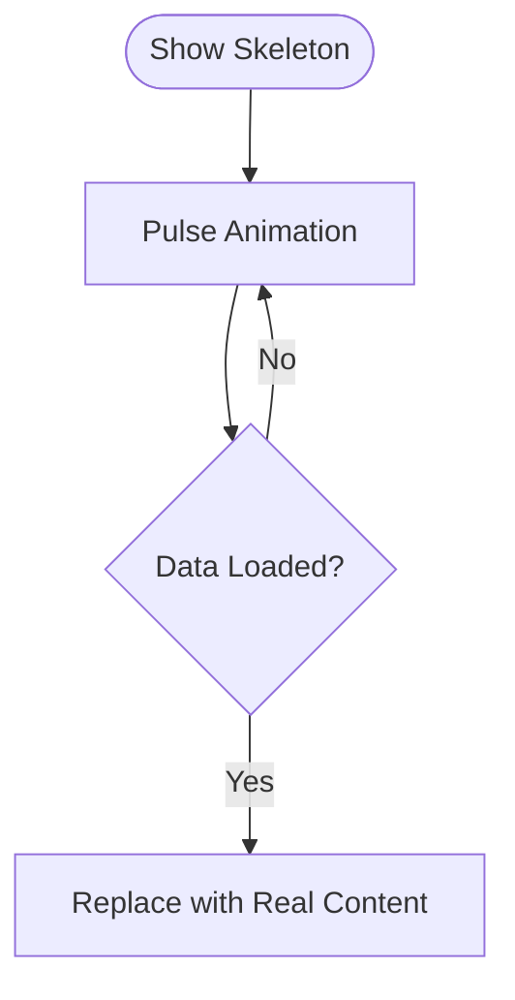
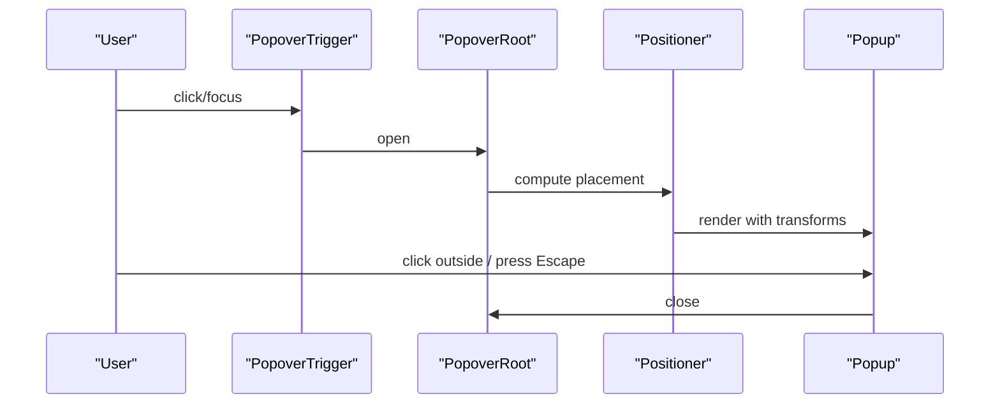
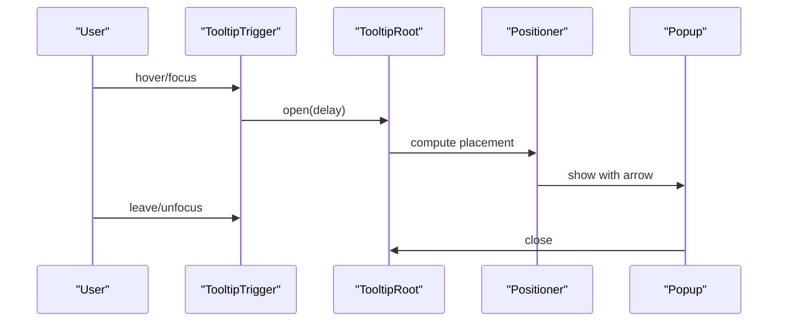
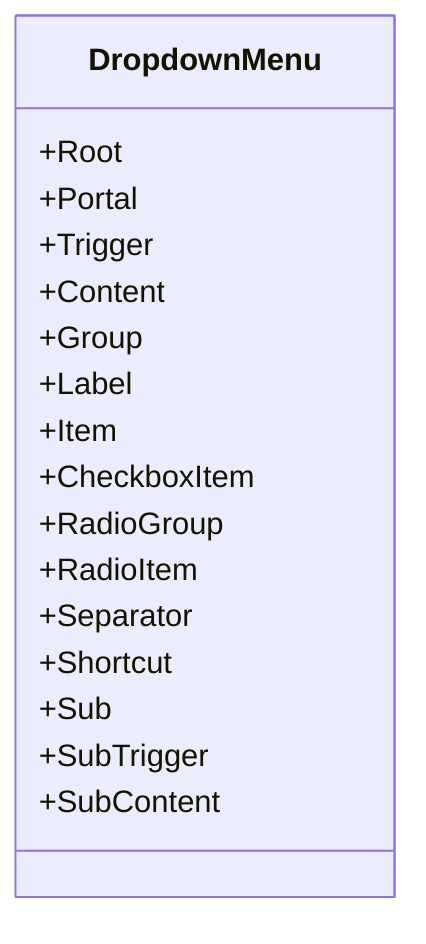
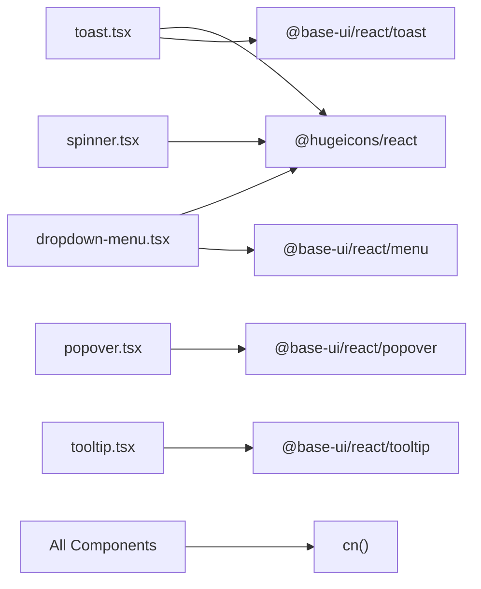

# Feedback Components

<cite>
**Referenced Files in This Document**
- [toast.tsx](file://Apps/Web/src/components/ui/toast.tsx)
- [spinner.tsx](file://Apps/Web/src/components/ui/spinner.tsx)
- [skeleton.tsx](file://Apps/Web/src/components/ui/skeleton.tsx)
- [popover.tsx](file://Apps/Web/src/components/ui/popover.tsx)
- [tooltip.tsx](file://Apps/Web/src/components/ui/tooltip.tsx)
- [dropdown-menu.tsx](file://Apps/Web/src/components/ui/dropdown-menu.tsx)
</cite>

## Table of Contents
1. [Introduction](#introduction)
2. [Project Structure](#project-structure)
3. [Core Components](#core-components)
4. [Architecture Overview](#architecture-overview)
5. [Detailed Component Analysis](#detailed-component-analysis)
6. [Dependency Analysis](#dependency-analysis)
7. [Performance Considerations](#performance-considerations)
8. [Troubleshooting Guide](#troubleshooting-guide)
9. [Conclusion](#conclusion)

## Introduction
This document provides comprehensive documentation for the feedback and interactive UI components: Toast, Spinner, Skeleton, Popover, Tooltip, and DropdownMenu. It explains component lifecycles, state management, user interaction patterns, animation configurations, positioning strategies, accessibility implementations, and performance considerations. The goal is to help you provide effective user feedback, implement loading states, and build contextual help systems with accessible, performant components.

## Project Structure
The components are implemented as small, focused React components under a shared UI library folder. Each component wraps primitives from @base-ui/react (where applicable), applies consistent styling via a utility class merger, and exposes a stable API for consumers.

**Diagram sources**
- [toast.tsx:1-11](file://Apps/Web/src/components/ui/toast.tsx#L1-L11)
- [popover.tsx:1-9](file://Apps/Web/src/components/ui/popover.tsx#L1-L9)
- [tooltip.tsx:1-12](file://Apps/Web/src/components/ui/tooltip.tsx#L1-L12)
- [dropdown-menu.tsx:1-11](file://Apps/Web/src/components/ui/dropdown-menu.tsx#L1-L11)
- [spinner.tsx:1-8](file://Apps/Web/src/components/ui/spinner.tsx#L1-L8)
- [skeleton.tsx:1-8](file://Apps/Web/src/components/ui/skeleton.tsx#L1-L8)

**Section sources**
- [toast.tsx:1-236](file://Apps/Web/src/components/ui/toast.tsx#L1-L236)
- [spinner.tsx:1-12](file://Apps/Web/src/components/ui/spinner.tsx#L1-L12)
- [skeleton.tsx:1-14](file://Apps/Web/src/components/ui/skeleton.tsx#L1-L14)
- [popover.tsx:1-90](file://Apps/Web/src/components/ui/popover.tsx#L1-L90)
- [tooltip.tsx:1-54](file://Apps/Web/src/components/ui/tooltip.tsx#L1-L54)
- [dropdown-menu.tsx:1-259](file://Apps/Web/src/components/ui/dropdown-menu.tsx#L1-L259)

## Core Components
- Toast: Global notification system with stacking, swipe gestures, animations, and action/close controls.
- Spinner: Lightweight loading indicator using an animated icon.
- Skeleton: Placeholder that pulses while content loads.
- Popover: Contextual overlay with configurable placement and entrance/exit animations.
- Tooltip: Small contextual hint with optional delay and arrow.
- DropdownMenu: Accessible menu with items, groups, checkboxes, radio groups, separators, shortcuts, and nested submenus.

Key responsibilities:
- Provide consistent visual language and behavior across feedback and interactive surfaces.
- Ensure accessibility through ARIA attributes, keyboard navigation, and focus management.
- Offer flexible configuration for positioning, animations, and theming.

**Section sources**
- [toast.tsx:11-236](file://Apps/Web/src/components/ui/toast.tsx#L11-L236)
- [spinner.tsx:5-11](file://Apps/Web/src/components/ui/spinner.tsx#L5-L11)
- [skeleton.tsx:3-13](file://Apps/Web/src/components/ui/skeleton.tsx#L3-L13)
- [popover.tsx:7-89](file://Apps/Web/src/components/ui/popover.tsx#L7-L89)
- [tooltip.tsx:6-53](file://Apps/Web/src/components/ui/tooltip.tsx#L6-L53)
- [dropdown-menu.tsx:9-258](file://Apps/Web/src/components/ui/dropdown-menu.tsx#L9-L258)

## Architecture Overview
All interactive overlays (Popover, Tooltip, DropdownMenu) use portals to render outside the normal DOM hierarchy, ensuring correct z-indexing and avoiding overflow clipping. Toast uses a dedicated viewport and portal to stack notifications at the bottom of the screen.

**Diagram sources**
- [toast.tsx:201-216](file://Apps/Web/src/components/ui/toast.tsx#L201-L216)
- [popover.tsx:15-47](file://Apps/Web/src/components/ui/popover.tsx#L15-L47)
- [tooltip.tsx:18-51](file://Apps/Web/src/components/ui/tooltip.tsx#L18-L51)
- [dropdown-menu.tsx:21-50](file://Apps/Web/src/components/ui/dropdown-menu.tsx#L21-L50)

## Detailed Component Analysis

### Toast
Lifecycle and state:
- A global toast manager maintains a list of active toasts.
- Toaster renders a provider, portal, viewport, and a list of toasts.
- Each toast supports enter/exit animations, stacking offsets, scaling, and swipe directions.
- Types include success, info, warning, error, and loading, each with a corresponding icon.

User interactions:
- Close button dismisses individual toasts.
- Action slot allows custom actions.
- Swipe gestures trigger directional exit animations.

Accessibility:
- Focusable elements and aria-label on close button.
- Semantic title and description slots.

Animation configuration:
- CSS variables control height, offset, scale, and stacking gap.
- Transitions animate transform, opacity, and height.

Positioning strategy:
- Fixed viewport at the bottom center, responsive adjustments for larger screens.

Memory management:
- Toast items are keyed by unique IDs; ensure toasts are dismissed when no longer needed.

**Diagram sources**
- [toast.tsx:11-11](file://Apps/Web/src/components/ui/toast.tsx#L11-L11)
- [toast.tsx:183-199](file://Apps/Web/src/components/ui/toast.tsx#L183-L199)
- [toast.tsx:201-216](file://Apps/Web/src/components/ui/toast.tsx#L201-L216)

**Section sources**
- [toast.tsx:11-236](file://Apps/Web/src/components/ui/toast.tsx#L11-L236)

### Spinner
Lifecycle and state:
- Stateless component rendering an animated icon.
- Role and aria-label mark it as a loading status for assistive technologies.

Usage patterns:
- Show during async operations or data fetching.
- Combine with Skeleton for richer loading UX.

Accessibility:
- role="status" and aria-label="Loading".

Animation configuration:
- Uses a spin animation class.

**Diagram sources**
- [spinner.tsx:5-8](file://Apps/Web/src/components/ui/spinner.tsx#L5-L8)

**Section sources**
- [spinner.tsx:1-12](file://Apps/Web/src/components/ui/spinner.tsx#L1-L12)

### Skeleton
Lifecycle and state:
- Stateless placeholder with a pulsing animation.
- Used to occupy space while content is loading.

Usage patterns:
- Wrap text, images, or complex cards during initial load.
- Hide once data arrives to avoid layout shifts.

Accessibility:
- No special ARIA; typically used alongside real content that becomes visible later.

Animation configuration:
- Pulse animation with rounded background.

**Diagram sources**
- [skeleton.tsx:3-10](file://Apps/Web/src/components/ui/skeleton.tsx#L3-L10)

**Section sources**
- [skeleton.tsx:1-14](file://Apps/Web/src/components/ui/skeleton.tsx#L1-L14)

### Popover
Lifecycle and state:
- Root, Trigger, and Content components manage open/closed state.
- Positioner computes placement based on side and align props.
- Portal ensures overlay renders above other content.

User interactions:
- Trigger opens/closes popover.
- Click outside or Escape closes it.

Accessibility:
- Managed by primitive; includes focus trapping and ARIA roles.

Animation configuration:
- Entrance/exit animations based on side and open/closed states.

Positioning strategy:
- Configurable side (top/bottom/left/right) and alignment with offsets.

**Diagram sources**
- [popover.tsx:7-47](file://Apps/Web/src/components/ui/popover.tsx#L7-L47)

**Section sources**
- [popover.tsx:1-90](file://Apps/Web/src/components/ui/popover.tsx#L1-L90)

### Tooltip
Lifecycle and state:
- Provider configures default delay.
- Root, Trigger, and Content manage delayed open and closed states.
- Arrow element visually points to the trigger.

User interactions:
- Hover or focus triggers tooltip after configured delay.
- Moves away or unfocus hides tooltip.

Accessibility:
- Managed by primitive; includes appropriate roles and focus handling.

Animation configuration:
- Fade-in/zoom-in on open, fade-out/zoom-out on close.

Positioning strategy:
- Side and alignment with offsets; arrow positioned accordingly.

**Diagram sources**
- [tooltip.tsx:6-51](file://Apps/Web/src/components/ui/tooltip.tsx#L6-L51)

**Section sources**
- [tooltip.tsx:1-54](file://Apps/Web/src/components/ui/tooltip.tsx#L1-L54)

### DropdownMenu
Lifecycle and state:
- Root, Trigger, and Content manage menu open/closed state.
- Supports groups, labels, items, checkboxes, radio groups, separators, shortcuts, and submenus.
- Submenus have their own content and positioning.

User interactions:
- Keyboard navigation between items and submenus.
- Checkboxes and radio items toggle state.

Accessibility:
- Primitive manages roles, focus traversal, and ARIA attributes.

Animation configuration:
- Entrance/exit animations based on side and open/closed states.

Positioning strategy:
- Configurable side and alignment; submenu defaults to right side.

**Diagram sources**
- [dropdown-menu.tsx:9-258](file://Apps/Web/src/components/ui/dropdown-menu.tsx#L9-L258)

**Section sources**
- [dropdown-menu.tsx:1-259](file://Apps/Web/src/components/ui/dropdown-menu.tsx#L1-L259)

## Dependency Analysis
- All interactive overlays depend on @base-ui/react primitives for state, focus management, and positioning.
- Styling relies on a utility class merger and Tailwind-like utilities.
- Icons are provided by an icon library for consistent visuals.

**Diagram sources**
- [toast.tsx:1-11](file://Apps/Web/src/components/ui/toast.tsx#L1-L11)
- [popover.tsx:1-9](file://Apps/Web/src/components/ui/popover.tsx#L1-L9)
- [tooltip.tsx:1-12](file://Apps/Web/src/components/ui/tooltip.tsx#L1-L12)
- [dropdown-menu.tsx:1-11](file://Apps/Web/src/components/ui/dropdown-menu.tsx#L1-L11)
- [spinner.tsx:1-8](file://Apps/Web/src/components/ui/spinner.tsx#L1-L8)

**Section sources**
- [toast.tsx:1-236](file://Apps/Web/src/components/ui/toast.tsx#L1-L236)
- [popover.tsx:1-90](file://Apps/Web/src/components/ui/popover.tsx#L1-L90)
- [tooltip.tsx:1-54](file://Apps/Web/src/components/ui/tooltip.tsx#L1-L54)
- [dropdown-menu.tsx:1-259](file://Apps/Web/src/components/ui/dropdown-menu.tsx#L1-L259)
- [spinner.tsx:1-12](file://Apps/Web/src/components/ui/spinner.tsx#L1-L12)

## Performance Considerations
- Minimize re-renders:
  - Keep Toast payloads minimal; avoid heavy objects in toasts.
  - Use memoization for lists of toasts if many are displayed simultaneously.
- Avoid layout thrashing:
  - Prefer CSS transforms and opacity for animations instead of layout-affecting properties.
- Portal usage:
  - Overlays render in portals to prevent clipping; keep content lightweight.
- Memory management:
  - Dismiss toasts promptly; ensure cleanup on unmount where necessary.
  - Avoid retaining references to large data in tooltips/popovers unless needed.
- Accessibility and input:
  - Ensure focus management remains efficient; rely on primitives for robust behavior.

[No sources needed since this section provides general guidance]

## Troubleshooting Guide
Common issues and resolutions:
- Toast not appearing:
  - Ensure Toaster is mounted in the app tree.
  - Verify toast manager is initialized and toasts are added correctly.
- Overlay clipped or behind content:
  - Confirm portal usage and sufficient z-index context.
- Tooltip/Popover mispositioned:
  - Adjust side, align, and offsets; check container boundaries.
- Dropdown keyboard navigation not working:
  - Ensure proper nesting of items and groups; verify focus is within the menu.
- Animations janky:
  - Reduce complexity of animated children; prefer GPU-accelerated properties.

**Section sources**
- [toast.tsx:201-216](file://Apps/Web/src/components/ui/toast.tsx#L201-L216)
- [popover.tsx:15-47](file://Apps/Web/src/components/ui/popover.tsx#L15-L47)
- [tooltip.tsx:18-51](file://Apps/Web/src/components/ui/tooltip.tsx#L18-L51)
- [dropdown-menu.tsx:21-50](file://Apps/Web/src/components/ui/dropdown-menu.tsx#L21-L50)

## Conclusion
These feedback and interactive components provide a cohesive, accessible, and performant foundation for user notifications, loading states, and contextual help. By leveraging primitives for state and positioning, applying consistent animations, and following accessibility best practices, you can deliver high-quality user experiences across your application.

[No sources needed since this section summarizes without analyzing specific files]