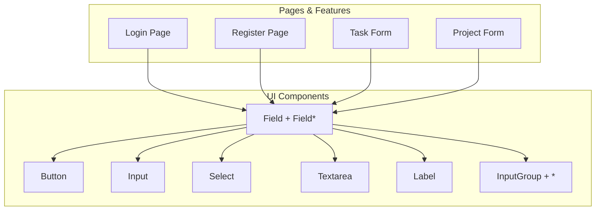
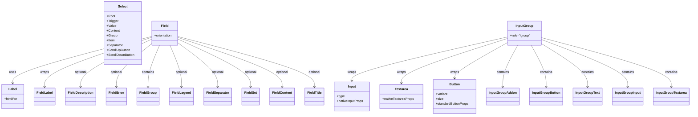
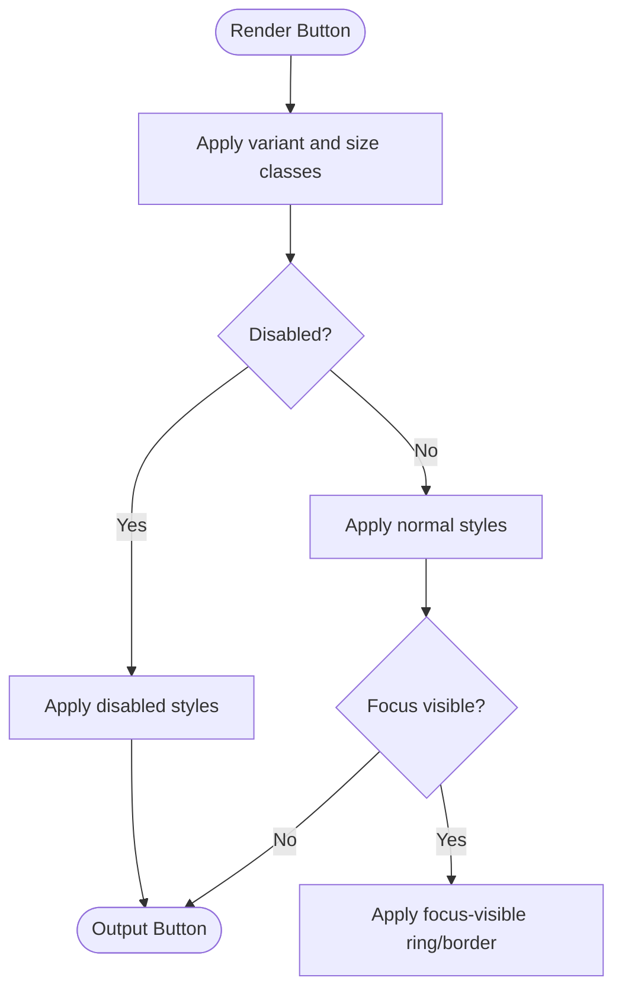
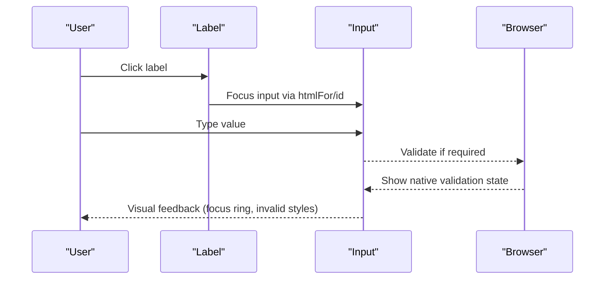
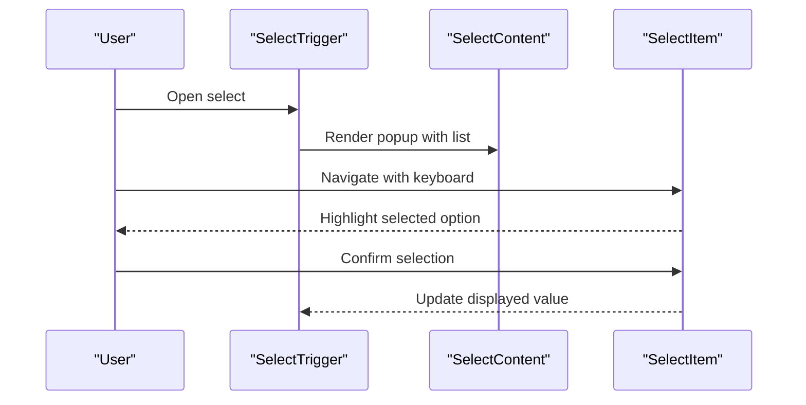
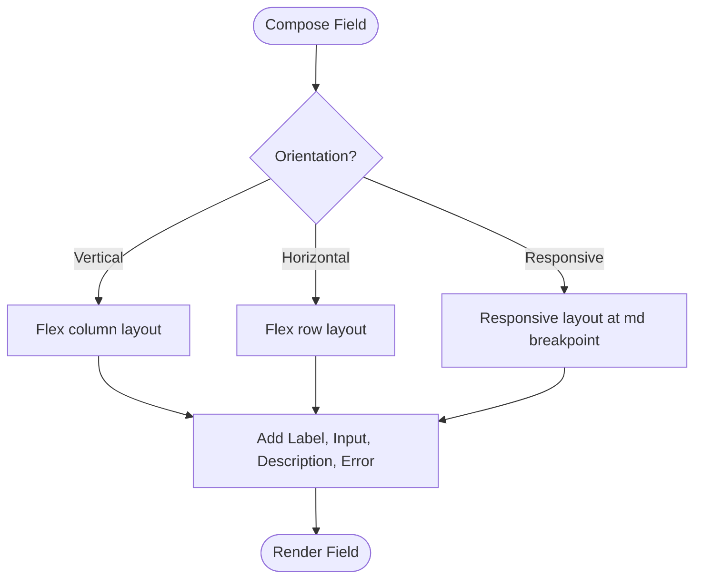
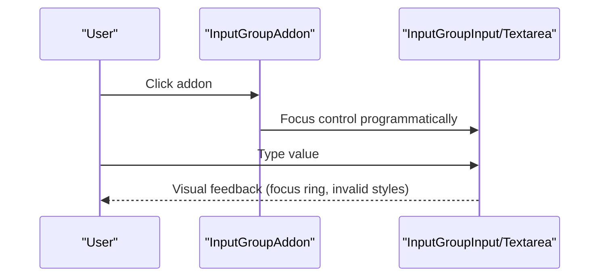
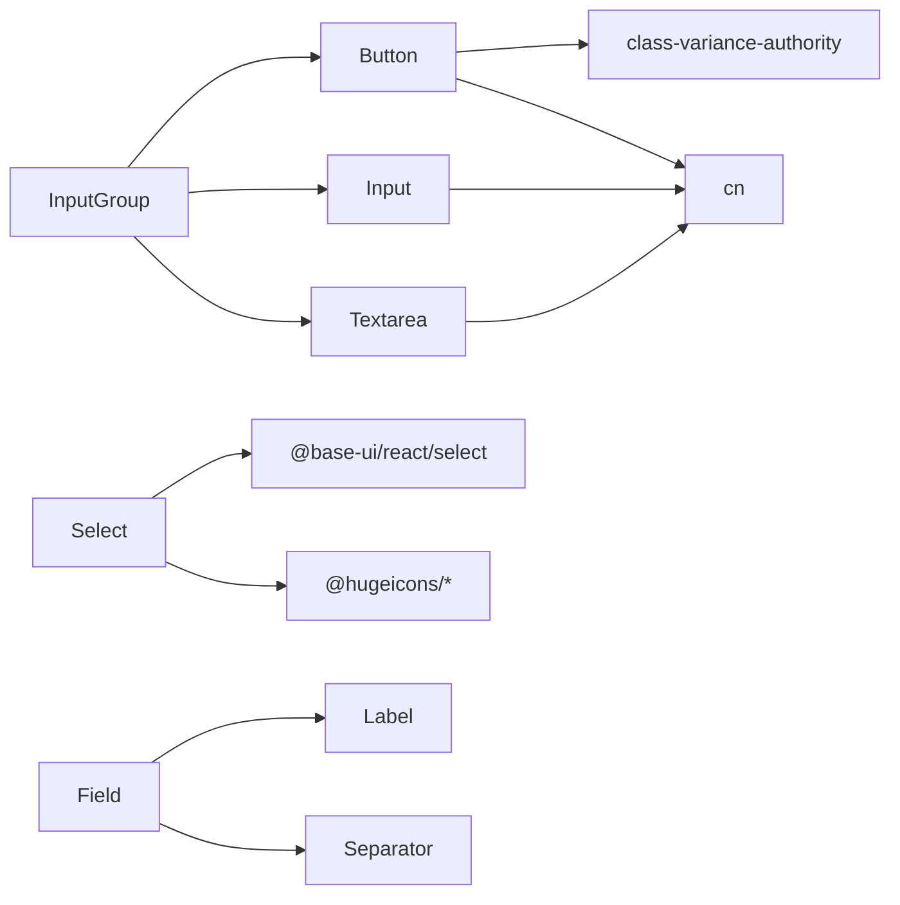

# Form Components

<cite>
**Referenced Files in This Document**
- [button.tsx](file://Apps/Web/src/components/ui/button.tsx)
- [input.tsx](file://Apps/Web/src/components/ui/input.tsx)
- [select.tsx](file://Apps/Web/src/components/ui/select.tsx)
- [textarea.tsx](file://Apps/Web/src/components/ui/textarea.tsx)
- [label.tsx](file://Apps/Web/src/components/ui/label.tsx)
- [field.tsx](file://Apps/Web/src/components/ui/field.tsx)
- [input-group.tsx](file://Apps/Web/src/components/ui/input-group.tsx)
- [login page.tsx](file://Apps/Web/src/app/(auth)/login/page.tsx)
- [register page.tsx](file://Apps/Web/src/app/(auth)/register/page.tsx)
- [task-form.tsx](file://Apps/Web/src/components/tasks-page/task-form.tsx)
- [project-form.tsx](file://Apps/Web/src/components/projects-page/project-form.tsx)
</cite>

## Table of Contents
1. [Introduction](#introduction)
2. [Project Structure](#project-structure)
3. [Core Components](#core-components)
4. [Architecture Overview](#architecture-overview)
5. [Detailed Component Analysis](#detailed-component-analysis)
6. [Dependency Analysis](#dependency-analysis)
7. [Performance Considerations](#performance-considerations)
8. [Troubleshooting Guide](#troubleshooting-guide)
9. [Conclusion](#conclusion)

## Introduction
This document provides comprehensive documentation for the form-related UI components used across the application: Button, Input, Select, Textarea, Label, Field, and InputGroup. It covers component props, validation states, accessibility features, styling customization options, practical usage patterns, error handling, keyboard navigation, screen reader support, and responsive design considerations. The goal is to help developers compose accessible, consistent, and user-friendly forms quickly and correctly.

## Project Structure
The form components live under a shared UI directory and are composed by feature pages and dialogs. Forms typically combine Field, Label, Input, Textarea, Select, and Button inside FieldGroup or FieldSet containers.

**Diagram sources**
- [button.tsx:1-58](file://Apps/Web/src/components/ui/button.tsx#L1-L58)
- [input.tsx:1-20](file://Apps/Web/src/components/ui/input.tsx#L1-L20)
- [select.tsx:1-200](file://Apps/Web/src/components/ui/select.tsx#L1-L200)
- [textarea.tsx:1-18](file://Apps/Web/src/components/ui/textarea.tsx#L1-L18)
- [label.tsx:1-20](file://Apps/Web/src/components/ui/label.tsx#L1-L20)
- [field.tsx:1-239](file://Apps/Web/src/components/ui/field.tsx#L1-L239)
- [input-group.tsx:1-159](file://Apps/Web/src/components/ui/input-group.tsx#L1-L159)
- [login page.tsx:73-103](file://Apps/Web/src/app/(auth)/login/page.tsx#L73-L103)
- [register page.tsx:87-105](file://Apps/Web/src/app/(auth)/register/page.tsx#L87-L105)
- [task-form.tsx:164-188](file://Apps/Web/src/components/tasks-page/task-form.tsx#L164-L188)
- [project-form.tsx:130-154](file://Apps/Web/src/components/projects-page/project-form.tsx#L130-L154)

**Section sources**
- [button.tsx:1-58](file://Apps/Web/src/components/ui/button.tsx#L1-L58)
- [input.tsx:1-20](file://Apps/Web/src/components/ui/input.tsx#L1-L20)
- [select.tsx:1-200](file://Apps/Web/src/components/ui/select.tsx#L1-L200)
- [textarea.tsx:1-18](file://Apps/Web/src/components/ui/textarea.tsx#L1-L18)
- [label.tsx:1-20](file://Apps/Web/src/components/ui/label.tsx#L1-L20)
- [field.tsx:1-239](file://Apps/Web/src/components/ui/field.tsx#L1-L239)
- [input-group.tsx:1-159](file://Apps/Web/src/components/ui/input-group.tsx#L1-L159)

## Core Components
This section summarizes each component’s purpose, key props, validation and accessibility behavior, and customization options.

- Button
  - Purpose: Primary interactive control for actions like submit, cancel, or toggles.
  - Key props: variant (default, outline, secondary, ghost, destructive, link), size (default, xs, sm, lg, icon variants), plus standard button attributes.
  - Validation state: Uses aria-invalid styles when invalid; supports focus-visible ring and disabled states.
  - Accessibility: Focusable, keyboard operable, supports icons via data-slot conventions.
  - Styling: Class-variance-authority variants; theme-aware colors and dark mode.

- Input
  - Purpose: Single-line text input with native semantics.
  - Key props: type, placeholder, required, disabled, plus all native input attributes.
  - Validation state: aria-invalid styles; focus-visible ring; disabled visual feedback.
  - Accessibility: Native label association via htmlFor/id; supports autocomplete.
  - Styling: Consistent height, border, focus ring, and dark mode.

- Select
  - Purpose: Accessible dropdown selection with grouped items and labels.
  - Key parts: Root, Trigger, Value, Content, Group, Item, Separator, Scroll buttons.
  - Key props: size on Trigger, positioning props on Content, item grouping via Group and Label.
  - Validation state: aria-invalid styles on trigger; disabled states.
  - Accessibility: Keyboard navigation within popup; ARIA roles provided by primitive; focus management handled internally.
  - Styling: Animated open/close, scroll indicators, and consistent sizing.

- Textarea
  - Purpose: Multi-line text input with auto-sizing content area.
  - Key props: placeholder, required, disabled, plus all native textarea attributes.
  - Validation state: aria-invalid styles; focus-visible ring; disabled visual feedback.
  - Accessibility: Native semantics; works with Label htmlFor/id.
  - Styling: Responsive min-height, focus ring, and dark mode.

- Label
  - Purpose: Accessible label for inputs and field groups.
  - Key props: htmlFor to associate with input id; className overrides.
  - Validation state: Peer-disabled and group-disabled opacity changes.
  - Accessibility: Semantic label element; improves screen reader context.
  - Styling: Size, spacing, and disabled states.

- Field and Field*
  - Purpose: Composable layout primitives for form fields, including Label, Title, Description, Error, Separator, Legend, Set, and Group.
  - Key props: orientation (vertical, horizontal, responsive) on Field; variant on Legend; children structure.
  - Validation state: Invalid color and error display via FieldError; role="alert" for errors.
  - Accessibility: Grouping semantics; semantic legend and separator; alert role for errors.
  - Styling: Container queries and responsive layouts; consistent spacing and focus rings.

- InputGroup and *
  - Purpose: Composite control that combines an input/textarea with addons, buttons, and text elements.
  - Key parts: Addon (inline-start/end, block-start/end), Button, Text, Input, Textarea.
  - Key props: align on Addon; size on Button; type on Button (button/submit/reset).
  - Validation state: Inherits invalid styles from child controls; focus-within behaviors.
  - Accessibility: Groups related controls; click-to-focus behavior on addon.
  - Styling: Unified border, focus ring, and alignment variants.

**Section sources**
- [button.tsx:5-57](file://Apps/Web/src/components/ui/button.tsx#L5-L57)
- [input.tsx:5-19](file://Apps/Web/src/components/ui/input.tsx#L5-L19)
- [select.tsx:9-199](file://Apps/Web/src/components/ui/select.tsx#L9-L199)
- [textarea.tsx:4-17](file://Apps/Web/src/components/ui/textarea.tsx#L4-L17)
- [label.tsx:6-19](file://Apps/Web/src/components/ui/label.tsx#L6-L19)
- [field.tsx:10-238](file://Apps/Web/src/components/ui/field.tsx#L10-L238)
- [input-group.tsx:11-158](file://Apps/Web/src/components/ui/input-group.tsx#L11-L158)

## Architecture Overview
The form system is built around composable primitives:
- Base primitives provide accessibility and interaction logic.
- Styled wrappers add consistent visual design and theme support.
- Field and Field* provide layout and messaging.
- InputGroup composes inputs with contextual controls.

**Diagram sources**
- [button.tsx:42-57](file://Apps/Web/src/components/ui/button.tsx#L42-L57)
- [input.tsx:5-19](file://Apps/Web/src/components/ui/input.tsx#L5-L19)
- [select.tsx:9-199](file://Apps/Web/src/components/ui/select.tsx#L9-L199)
- [textarea.tsx:4-17](file://Apps/Web/src/components/ui/textarea.tsx#L4-L17)
- [label.tsx:6-19](file://Apps/Web/src/components/ui/label.tsx#L6-L19)
- [field.tsx:10-238](file://Apps/Web/src/components/ui/field.tsx#L10-L238)
- [input-group.tsx:11-158](file://Apps/Web/src/components/ui/input-group.tsx#L11-L158)

## Detailed Component Analysis

### Button
- Props
  - variant: default, outline, secondary, ghost, destructive, link
  - size: default, xs, sm, lg, icon, icon-xs, icon-sm, icon-lg
  - All standard HTML button attributes via spread props
- Validation States
  - aria-invalid styles applied when parent sets invalid state
  - Disabled state with reduced opacity and pointer-events none
- Accessibility
  - Focus-visible ring and border for keyboard users
  - Icon support via data-slot conventions
- Styling Customization
  - Variants defined via class-variance-authority
  - Theme variables for colors and dark mode
- Usage Patterns
  - Use as submit/cancel buttons in forms
  - Combine with loading indicators and disabled states during async operations

**Diagram sources**
- [button.tsx:5-40](file://Apps/Web/src/components/ui/button.tsx#L5-L40)
- [button.tsx:42-57](file://Apps/Web/src/components/ui/button.tsx#L42-L57)

**Section sources**
- [button.tsx:5-57](file://Apps/Web/src/components/ui/button.tsx#L5-L57)

### Input
- Props
  - type: text, email, password, number, etc.
  - placeholder, required, disabled, autoComplete, and all native input attributes
- Validation States
  - aria-invalid styles for invalid state
  - Disabled state with reduced opacity and cursor not allowed
- Accessibility
  - Native input semantics; pair with Label htmlFor/id
  - Supports browser-native validation and autocomplete
- Styling Customization
  - Consistent height, border, focus ring, and dark mode
  - Placeholder and file input styling included
- Usage Patterns
  - Single-line text entry
  - Combine with Field and FieldLabel for structured forms

**Diagram sources**
- [input.tsx:5-19](file://Apps/Web/src/components/ui/input.tsx#L5-L19)
- [label.tsx:6-19](file://Apps/Web/src/components/ui/label.tsx#L6-L19)

**Section sources**
- [input.tsx:5-19](file://Apps/Web/src/components/ui/input.tsx#L5-L19)
- [label.tsx:6-19](file://Apps/Web/src/components/ui/label.tsx#L6-L19)

### Select
- Parts and Props
  - Root: Select
  - Trigger: SelectTrigger with size prop
  - Value: SelectValue
  - Content: SelectContent with positioning props (side, sideOffset, align, alignOffset, alignItemWithTrigger)
  - Group: SelectGroup
  - Item: SelectItem
  - Separator: SelectSeparator
  - Scroll buttons: SelectScrollUpButton, SelectScrollDownButton
- Validation States
  - aria-invalid styles on trigger
  - Disabled state on trigger and items
- Accessibility
  - Keyboard navigation within popup
  - ARIA roles and states managed by primitive
- Styling Customization
  - Animated open/close transitions
  - Scroll indicators and consistent sizing
- Usage Patterns
  - Dropdown selection with grouped items and labels
  - Combine with Field and FieldLabel

**Diagram sources**
- [select.tsx:31-57](file://Apps/Web/src/components/ui/select.tsx#L31-L57)
- [select.tsx:59-96](file://Apps/Web/src/components/ui/select.tsx#L59-L96)
- [select.tsx:111-137](file://Apps/Web/src/components/ui/select.tsx#L111-L137)

**Section sources**
- [select.tsx:9-199](file://Apps/Web/src/components/ui/select.tsx#L9-L199)

### Textarea
- Props
  - placeholder, required, disabled, and all native textarea attributes
- Validation States
  - aria-invalid styles for invalid state
  - Disabled state with reduced opacity and cursor not allowed
- Accessibility
  - Native textarea semantics; pair with Label htmlFor/id
- Styling Customization
  - Auto-sizing content area, focus ring, and dark mode
- Usage Patterns
  - Multi-line text entry
  - Combine with Field and FieldLabel

**Section sources**
- [textarea.tsx:4-17](file://Apps/Web/src/components/ui/textarea.tsx#L4-L17)

### Label
- Props
  - htmlFor to associate with input id
  - className overrides
- Validation States
  - Peer-disabled and group-disabled opacity changes
- Accessibility
  - Semantic label element; improves screen reader context
- Styling Customization
  - Size, spacing, and disabled states
- Usage Patterns
  - Always pair with Input/Textarea/Select via htmlFor/id

**Section sources**
- [label.tsx:6-19](file://Apps/Web/src/components/ui/label.tsx#L6-L19)

### Field and Field*
- Purpose
  - Provide layout, grouping, labeling, description, and error messaging for form fields.
- Key Components
  - Field: container with orientation (vertical, horizontal, responsive)
  - FieldLabel: styled label wrapper
  - FieldTitle: non-interactive title
  - FieldDescription: helper text
  - FieldError: error messages with role="alert"
  - FieldGroup: grouped fields container
  - FieldLegend: legend for FieldSet
  - FieldSeparator: divider with optional content
  - FieldSet: semantic fieldset
  - FieldContent: content wrapper
- Validation States
  - Invalid color and error display via FieldError
  - role="alert" for errors ensures screen reader announcements
- Accessibility
  - Grouping semantics; semantic legend and separator; alert role for errors
- Styling Customization
  - Container queries and responsive layouts
  - Consistent spacing and focus rings
- Usage Patterns
  - Wrap each input with Field and FieldLabel
  - Use FieldDescription for hints
  - Use FieldError for validation messages
  - Use FieldGroup to organize multiple fields
  - Use FieldSet and FieldLegend for complex sections

**Diagram sources**
- [field.tsx:54-86](file://Apps/Web/src/components/ui/field.tsx#L54-L86)
- [field.tsx:101-143](file://Apps/Web/src/components/ui/field.tsx#L101-L143)
- [field.tsx:176-225](file://Apps/Web/src/components/ui/field.tsx#L176-L225)

**Section sources**
- [field.tsx:10-238](file://Apps/Web/src/components/ui/field.tsx#L10-L238)

### InputGroup and *
- Purpose
  - Combine an input/textarea with contextual controls such as addons, buttons, and text.
- Key Components
  - InputGroup: container with role="group"
  - InputGroupAddon: contextual text/icons/buttons with align (inline-start/end, block-start/end)
  - InputGroupButton: button sized for input group
  - InputGroupText: static text
  - InputGroupInput: input without borders/rings
  - InputGroupTextarea: textarea without borders/rings
- Validation States
  - Inherits invalid styles from child controls
  - Focus-within behaviors for composite focus
- Accessibility
  - Groups related controls; click-to-focus behavior on addon
- Styling Customization
  - Unified border, focus ring, and alignment variants
- Usage Patterns
  - Prefix/suffix text or icons with Addon
  - Action buttons with InputGroupButton
  - Static labels with InputGroupText

**Diagram sources**
- [input-group.tsx:46-66](file://Apps/Web/src/components/ui/input-group.tsx#L46-L66)
- [input-group.tsx:119-149](file://Apps/Web/src/components/ui/input-group.tsx#L119-L149)

**Section sources**
- [input-group.tsx:11-158](file://Apps/Web/src/components/ui/input-group.tsx#L11-L158)

## Dependency Analysis
- Button depends on base-ui/react/button and class-variance-authority for variants.
- Input and Textarea depend on cn for class merging and use native elements.
- Select depends on base-ui/react/select and icon libraries for visuals.
- Field components depend on Label and Separator for layout and semantics.
- InputGroup composes Button, Input, and Textarea.

**Diagram sources**
- [button.tsx:1-3](file://Apps/Web/src/components/ui/button.tsx#L1-L3)
- [input.tsx:1-3](file://Apps/Web/src/components/ui/input.tsx#L1-L3)
- [textarea.tsx:1-2](file://Apps/Web/src/components/ui/textarea.tsx#L1-L2)
- [select.tsx:1-7](file://Apps/Web/src/components/ui/select.tsx#L1-L7)
- [field.tsx:3-8](file://Apps/Web/src/components/ui/field.tsx#L3-L8)
- [input-group.tsx:3-9](file://Apps/Web/src/components/ui/input-group.tsx#L3-L9)

**Section sources**
- [button.tsx:1-3](file://Apps/Web/src/components/ui/button.tsx#L1-L3)
- [input.tsx:1-3](file://Apps/Web/src/components/ui/input.tsx#L1-L3)
- [textarea.tsx:1-2](file://Apps/Web/src/components/ui/textarea.tsx#L1-L2)
- [select.tsx:1-7](file://Apps/Web/src/components/ui/select.tsx#L1-L7)
- [field.tsx:3-8](file://Apps/Web/src/components/ui/field.tsx#L3-L8)
- [input-group.tsx:3-9](file://Apps/Web/src/components/ui/input-group.tsx#L3-L9)

## Performance Considerations
- Prefer controlled inputs only when necessary; uncontrolled inputs can reduce re-renders.
- Avoid heavy computations in render paths; memoize derived values where appropriate.
- Use FieldError’s useMemo pattern to deduplicate and compute error content efficiently.
- Keep Select lists concise; virtualize large datasets if needed.
- Minimize unnecessary style recalculations by leveraging CSS classes and avoiding inline styles.

[No sources needed since this section provides general guidance]

## Troubleshooting Guide
Common issues and resolutions:
- Labels not associated with inputs
  - Ensure Label htmlFor matches Input id.
- Errors not announced by screen readers
  - Use FieldError which includes role="alert".
- Invalid state not visually indicated
  - Ensure parent sets aria-invalid or use FieldError to propagate invalid state.
- Focus not moving into InputGroup on addon click
  - Verify InputGroupAddon click handler focuses the control.
- Select not opening or closing properly
  - Check SelectContent positioning props and ensure it is rendered within a portal.

**Section sources**
- [field.tsx:176-225](file://Apps/Web/src/components/ui/field.tsx#L176-L225)
- [input-group.tsx:46-66](file://Apps/Web/src/components/ui/input-group.tsx#L46-L66)
- [select.tsx:59-96](file://Apps/Web/src/components/ui/select.tsx#L59-L96)

## Conclusion
The form components provide a robust, accessible, and customizable foundation for building user interfaces. By composing Field, Label, Input, Textarea, Select, Button, and InputGroup, you can create consistent forms with clear validation states, strong keyboard and screen reader support, and flexible styling. Follow the patterns shown here to ensure reliable user interactions, maintainable code, and inclusive experiences across devices.

[No sources needed since this section summarizes without analyzing specific files]