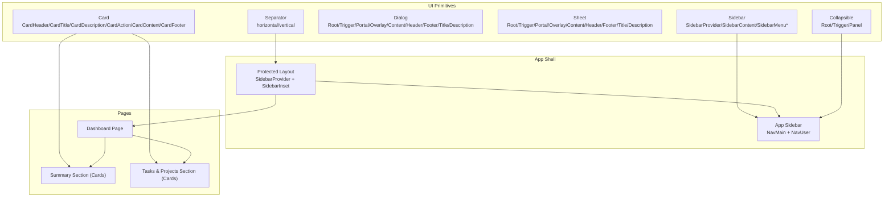
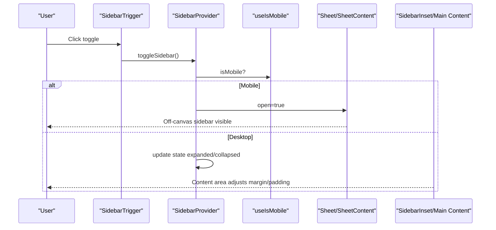
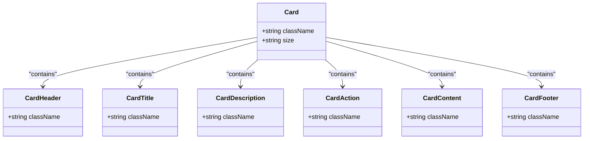
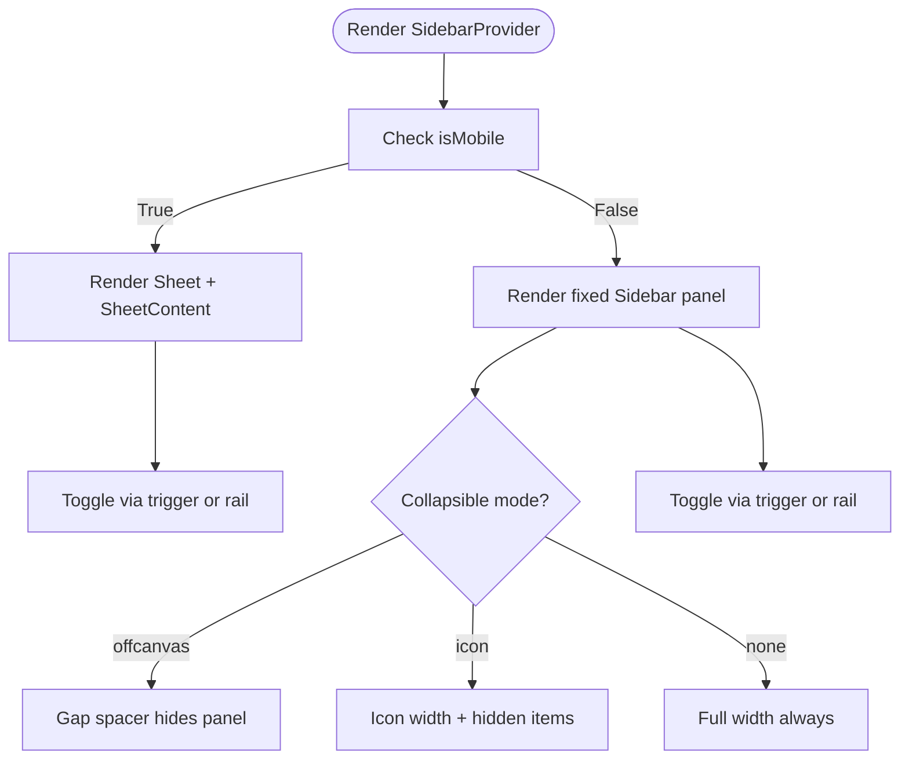
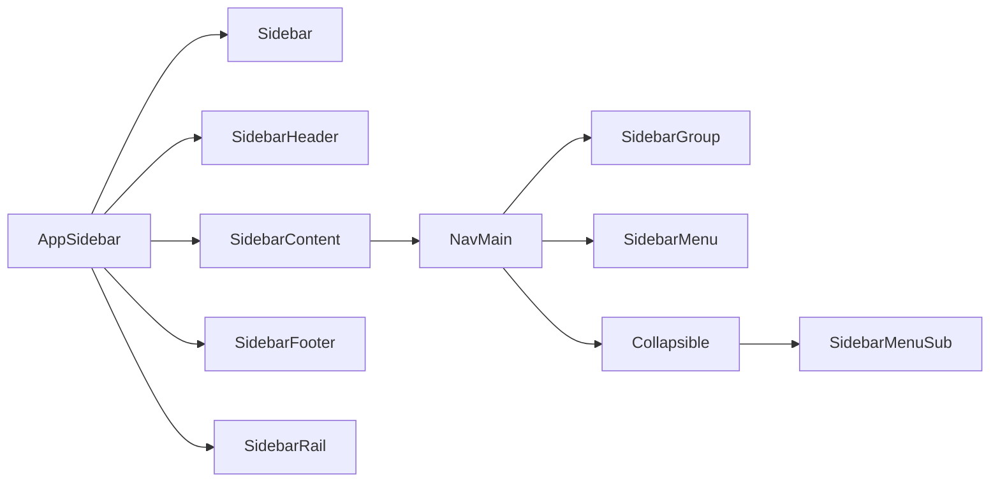
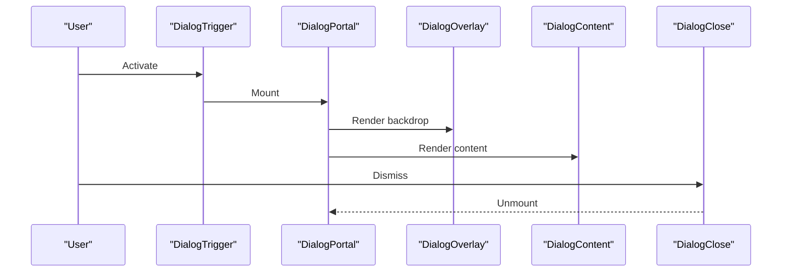
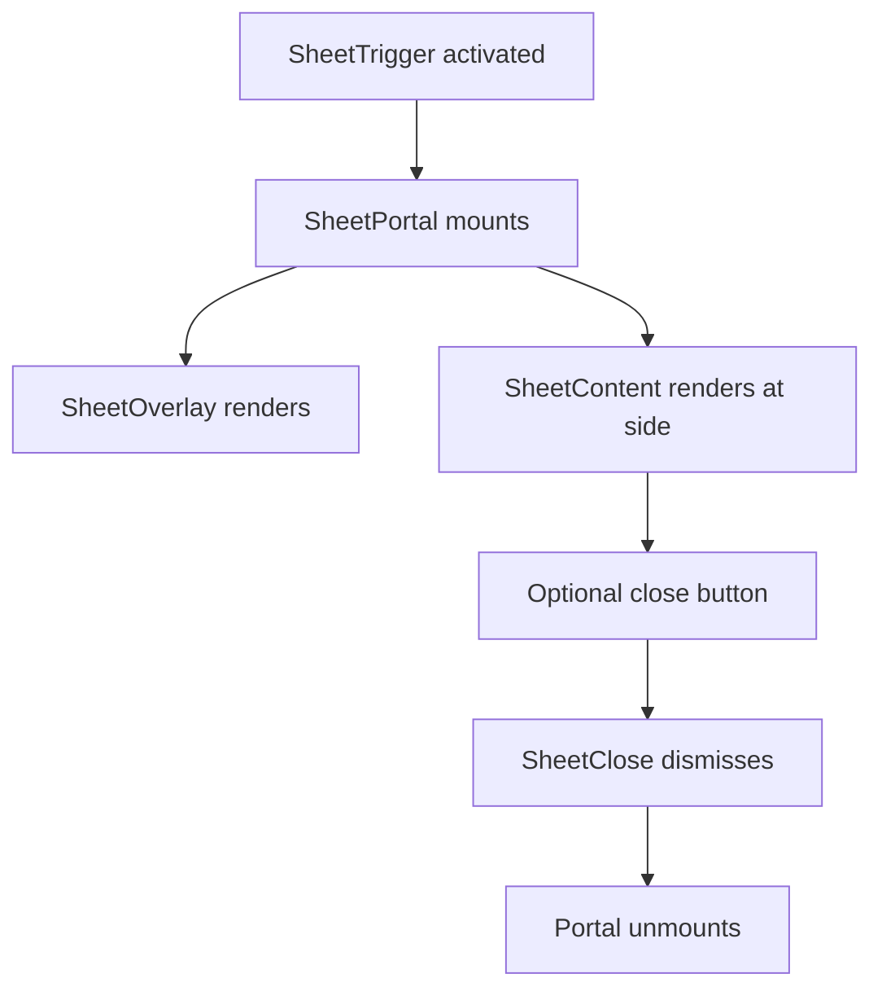
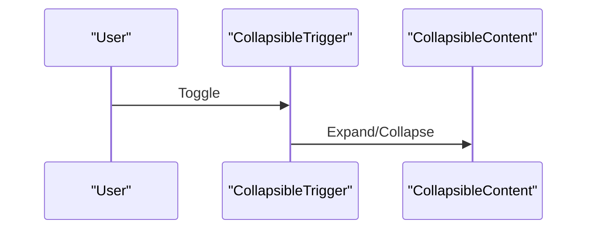
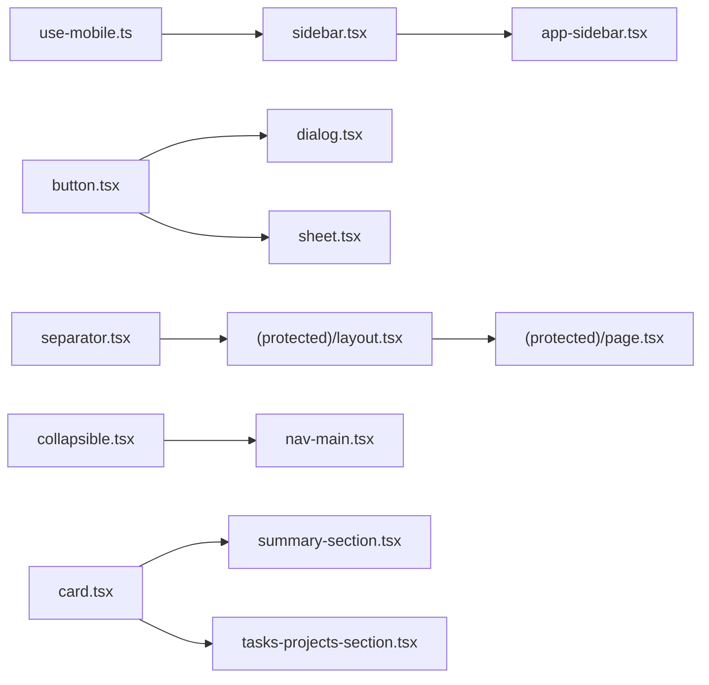

# Layout Components

<cite>
**Referenced Files in This Document**
- [card.tsx](file://Apps/Web/src/components/ui/card.tsx)
- [sidebar.tsx](file://Apps/Web/src/components/ui/sidebar.tsx)
- [dialog.tsx](file://Apps/Web/src/components/ui/dialog.tsx)
- [sheet.tsx](file://Apps/Web/src/components/ui/sheet.tsx)
- [collapsible.tsx](file://Apps/Web/src/components/ui/collapsible.tsx)
- [separator.tsx](file://Apps/Web/src/components/ui/separator.tsx)
- [app-sidebar.tsx](file://Apps/Web/src/components/app-sidebar.tsx)
- [nav-main.tsx](file://Apps/Web/src/components/nav-main.tsx)
- [use-mobile.ts](file://Apps/Web/src/hooks/use-mobile.ts)
- [layout.tsx](file://Apps/Web/src/app/(protected)/layout.tsx)
- [page.tsx](file://Apps/Web/src/app/(protected)/page.tsx)
- [summary-section.tsx](file://Apps/Web/src/components/main-page/summary-section.tsx)
- [tasks-projects-section.tsx](file://Apps/Web/src/components/main-page/tasks-projects-section.tsx)
</cite>

## Table of Contents
1. [Introduction](#introduction)
2. [Project Structure](#project-structure)
3. [Core Components](#core-components)
4. [Architecture Overview](#architecture-overview)
5. [Detailed Component Analysis](#detailed-component-analysis)
6. [Dependency Analysis](#dependency-analysis)
7. [Performance Considerations](#performance-considerations)
8. [Troubleshooting Guide](#troubleshooting-guide)
9. [Conclusion](#conclusion)

## Introduction
This document explains the layout and structural UI components used to build responsive, accessible interfaces: Card, Sidebar, Dialog, Sheet, Collapsible, and Separator. It covers component architecture, prop interfaces, composition patterns, positioning and z-index strategies, mobile responsiveness, and accessibility considerations for complex layouts.

## Project Structure
The layout system is implemented as a set of reusable UI primitives under src/components/ui, with higher-level composition in app-level layouts and feature pages. The protected route layout composes SidebarProvider, SidebarInset, and content sections that use Cards and Separators.

**Diagram sources**
- [card.tsx:1-88](file://Apps/Web/src/components/ui/card.tsx#L1-L88)
- [sidebar.tsx:1-694](file://Apps/Web/src/components/ui/sidebar.tsx#L1-L694)
- [dialog.tsx:1-140](file://Apps/Web/src/components/ui/dialog.tsx#L1-L140)
- [sheet.tsx:1-127](file://Apps/Web/src/components/ui/sheet.tsx#L1-L127)
- [collapsible.tsx:1-18](file://Apps/Web/src/components/ui/collapsible.tsx#L1-L18)
- [separator.tsx:1-21](file://Apps/Web/src/components/ui/separator.tsx#L1-L21)
- [app-sidebar.tsx:1-80](file://Apps/Web/src/components/app-sidebar.tsx#L1-L80)
- [layout.tsx:1-49](file://Apps/Web/src/app/(protected)/layout.tsx#L1-L49)
- [page.tsx:1-77](file://Apps/Web/src/app/(protected)/page.tsx#L1-L77)
- [summary-section.tsx:1-83](file://Apps/Web/src/components/main-page/summary-section.tsx#L1-L83)
- [tasks-projects-section.tsx:1-140](file://Apps/Web/src/components/main-page/tasks-projects-section.tsx#L1-L140)

**Section sources**
- [layout.tsx:1-49](file://Apps/Web/src/app/(protected)/layout.tsx#L1-L49)
- [page.tsx:1-77](file://Apps/Web/src/app/(protected)/page.tsx#L1-L77)

## Core Components
- Card: A container with semantic sub-parts (header, title, description, action, content, footer). Supports size variants and CSS custom properties for spacing.
- Sidebar: A full-featured navigation shell with provider context, mobile off-canvas behavior via Sheet, collapsible modes, rail resizing, and menu primitives.
- Dialog: An overlay-based modal built on Base UI, with portal, backdrop, focus management, and optional close button.
- Sheet: A side panel/modal using the same primitives as Dialog but oriented to edges with slide-in/out animations.
- Collapsible: A toggleable region for expanding/collapsing content.
- Separator: A visual divider supporting horizontal and vertical orientations.

Key responsibilities:
- Composition: Each component exposes small, focused parts that compose into larger structures.
- Responsiveness: Mobile-first behaviors are handled through media queries and hooks.
- Accessibility: Semantic roles, keyboard support, and screen-reader-friendly labels are provided by primitives and wrappers.

**Section sources**
- [card.tsx:1-88](file://Apps/Web/src/components/ui/card.tsx#L1-L88)
- [sidebar.tsx:1-694](file://Apps/Web/src/components/ui/sidebar.tsx#L1-L694)
- [dialog.tsx:1-140](file://Apps/Web/src/components/ui/dialog.tsx#L1-L140)
- [sheet.tsx:1-127](file://Apps/Web/src/components/ui/sheet.tsx#L1-L127)
- [collapsible.tsx:1-18](file://Apps/Web/src/components/ui/collapsible.tsx#L1-L18)
- [separator.tsx:1-21](file://Apps/Web/src/components/ui/separator.tsx#L1-L21)

## Architecture Overview
The application uses a layered approach:
- Primitive layer: Base UI primitives wrapped with consistent styling and data-slot attributes.
- Layout layer: SidebarProvider manages global state; SidebarInset reserves space for the main content.
- Feature layer: Pages compose cards, separators, and navigation elements.

**Diagram sources**
- [sidebar.tsx:53-144](file://Apps/Web/src/components/ui/sidebar.tsx#L53-L144)
- [sidebar.tsx:146-246](file://Apps/Web/src/components/ui/sidebar.tsx#L146-L246)
- [sidebar.tsx:248-268](file://Apps/Web/src/components/ui/sidebar.tsx#L248-L268)
- [use-mobile.ts:1-20](file://Apps/Web/src/hooks/use-mobile.ts#L1-L20)

## Detailed Component Analysis

### Card
Purpose:
- Provide a structured card surface with header/title/description/action/content/footer slots.
- Support size variants and CSS variables for spacing.

Prop interface highlights:
- Card: className, size ("default" | "sm"), plus standard div props.
- Subcomponents accept className and standard element props.

Composition pattern:
- Use CardHeader with CardTitle and CardDescription; place CardAction for icons or controls; CardContent for body; CardFooter for secondary actions or notes.

Responsive behavior:
- Grid-based page layouts combine multiple cards responsively.

Accessibility:
- Semantic structure aids assistive technologies; ensure meaningful titles and descriptions.

**Diagram sources**
- [card.tsx:4-87](file://Apps/Web/src/components/ui/card.tsx#L4-L87)

Usage examples:
- Dashboard summary cards: [summary-section.tsx:64-80](file://Apps/Web/src/components/main-page/summary-section.tsx#L64-L80)
- Task list and project list cards: [tasks-projects-section.tsx:27-85](file://Apps/Web/src/components/main-page/tasks-projects-section.tsx#L27-L85), [tasks-projects-section.tsx:87-136](file://Apps/Web/src/components/main-page/tasks-projects-section.tsx#L87-L136)

**Section sources**
- [card.tsx:1-88](file://Apps/Web/src/components/ui/card.tsx#L1-L88)
- [summary-section.tsx:1-83](file://Apps/Web/src/components/main-page/summary-section.tsx#L1-L83)
- [tasks-projects-section.tsx:1-140](file://Apps/Web/src/components/main-page/tasks-projects-section.tsx#L1-L140)

### Sidebar
Purpose:
- Provide a persistent navigation area with collapsible states, mobile off-canvas mode, resizable rail, and rich menu primitives.

Key props and behaviors:
- SidebarProvider: defaultOpen, open (controlled), onOpenChange (controlled), className, style, children. Persists state via cookie and supports keyboard shortcut.
- Sidebar: side ("left" | "right"), variant ("sidebar" | "floating" | "inset"), collapsible ("offcanvas" | "icon" | "none").
- Mobile: Renders inside Sheet when isMobile is true.
- Desktop: Fixed-positioned panel with gap spacer and transition classes.
- Context: Exposes state, open, setOpen, isMobile, openMobile, setOpenMobile, toggleSidebar.

Positioning and z-index:
- Uses fixed inset positioning and explicit z-indices for overlays and rails.

Accessibility:
- Screen reader-only headers for mobile sheet; aria-labels on trigger/rail; focus management handled by primitives.

**Diagram sources**
- [sidebar.tsx:53-144](file://Apps/Web/src/components/ui/sidebar.tsx#L53-L144)
- [sidebar.tsx:146-246](file://Apps/Web/src/components/ui/sidebar.tsx#L146-L246)
- [sidebar.tsx:248-293](file://Apps/Web/src/components/ui/sidebar.tsx#L248-L293)

Composition patterns:
- AppSidebar composes SidebarHeader, SidebarContent, SidebarFooter, and SidebarRail.
- NavMain composes SidebarGroup, SidebarMenu, Collapsible, and sub-menus.

**Diagram sources**
- [app-sidebar.tsx:1-80](file://Apps/Web/src/components/app-sidebar.tsx#L1-L80)
- [nav-main.tsx:1-69](file://Apps/Web/src/components/nav-main.tsx#L1-L69)
- [sidebar.tsx:319-445](file://Apps/Web/src/components/ui/sidebar.tsx#L319-L445)

**Section sources**
- [sidebar.tsx:1-694](file://Apps/Web/src/components/ui/sidebar.tsx#L1-L694)
- [app-sidebar.tsx:1-80](file://Apps/Web/src/components/app-sidebar.tsx#L1-L80)
- [nav-main.tsx:1-69](file://Apps/Web/src/components/nav-main.tsx#L1-L69)
- [use-mobile.ts:1-20](file://Apps/Web/src/hooks/use-mobile.ts#L1-L20)

### Dialog
Purpose:
- Present modal content over an overlay with proper focus trapping and animation.

Props and structure:
- Root, Trigger, Portal, Close, Overlay, Content, Header, Footer, Title, Description.
- Content includes optional close button and centered positioning with max-width constraints.

Positioning and z-index:
- Overlay and content both use high z-index to sit above app content.

Accessibility:
- Backdrop and popup semantics from primitives; close button includes sr-only label.

**Diagram sources**
- [dialog.tsx:11-72](file://Apps/Web/src/components/ui/dialog.tsx#L11-L72)

**Section sources**
- [dialog.tsx:1-140](file://Apps/Web/src/components/ui/dialog.tsx#L1-L140)

### Sheet
Purpose:
- Display a side panel or bottom/top drawer with slide transitions.

Props and structure:
- Root, Trigger, Close, Portal, Overlay, Content (with side prop), Header, Footer, Title, Description.
- Content positions and sizes based on side prop and includes optional close button.

Positioning and z-index:
- Fixed positioning with high z-index; animated translate offsets per side.

Accessibility:
- Backdrop and popup semantics from primitives; close button includes sr-only label.

**Diagram sources**
- [sheet.tsx:11-75](file://Apps/Web/src/components/ui/sheet.tsx#L11-L75)

**Section sources**
- [sheet.tsx:1-127](file://Apps/Web/src/components/ui/sheet.tsx#L1-L127)

### Collapsible
Purpose:
- Toggle visibility of content panels.

Props and structure:
- Root, Trigger, Panel (content). Used within Sidebar menus to expand sub-items.

Accessibility:
- Semantics provided by Base UI primitives; triggers should be labeled appropriately.

**Diagram sources**
- [collapsible.tsx:5-15](file://Apps/Web/src/components/ui/collapsible.tsx#L5-L15)

**Section sources**
- [collapsible.tsx:1-18](file://Apps/Web/src/components/ui/collapsible.tsx#L1-L18)
- [nav-main.tsx:37-63](file://Apps/Web/src/components/nav-main.tsx#L37-L63)

### Separator
Purpose:
- Draw a visual divider in horizontal or vertical orientation.

Props:
- orientation ("horizontal" | "vertical") and className.

Usage:
- In protected layout header to separate trigger and content.

**Section sources**
- [separator.tsx:1-21](file://Apps/Web/src/components/ui/separator.tsx#L1-L21)
- [layout.tsx:34-44](file://Apps/Web/src/app/(protected)/layout.tsx#L34-L44)

## Dependency Analysis
High-level dependencies among layout components and their usage in the app shell and pages.

**Diagram sources**
- [use-mobile.ts:1-20](file://Apps/Web/src/hooks/use-mobile.ts#L1-L20)
- [sidebar.tsx:1-694](file://Apps/Web/src/components/ui/sidebar.tsx#L1-L694)
- [dialog.tsx:1-140](file://Apps/Web/src/components/ui/dialog.tsx#L1-L140)
- [sheet.tsx:1-127](file://Apps/Web/src/components/ui/sheet.tsx#L1-L127)
- [separator.tsx:1-21](file://Apps/Web/src/components/ui/separator.tsx#L1-L21)
- [app-sidebar.tsx:1-80](file://Apps/Web/src/components/app-sidebar.tsx#L1-L80)
- [nav-main.tsx:1-69](file://Apps/Web/src/components/nav-main.tsx#L1-L69)
- [card.tsx:1-88](file://Apps/Web/src/components/ui/card.tsx#L1-L88)
- [summary-section.tsx:1-83](file://Apps/Web/src/components/main-page/summary-section.tsx#L1-L83)
- [tasks-projects-section.tsx:1-140](file://Apps/Web/src/components/main-page/tasks-projects-section.tsx#L1-L140)
- [layout.tsx:1-49](file://Apps/Web/src/app/(protected)/layout.tsx#L1-L49)
- [page.tsx:1-77](file://Apps/Web/src/app/(protected)/page.tsx#L1-L77)

**Section sources**
- [sidebar.tsx:1-694](file://Apps/Web/src/components/ui/sidebar.tsx#L1-L694)
- [dialog.tsx:1-140](file://Apps/Web/src/components/ui/dialog.tsx#L1-L140)
- [sheet.tsx:1-127](file://Apps/Web/src/components/ui/sheet.tsx#L1-L127)
- [collapsible.tsx:1-18](file://Apps/Web/src/components/ui/collapsible.tsx#L1-L18)
- [separator.tsx:1-21](file://Apps/Web/src/components/ui/separator.tsx#L1-L21)
- [app-sidebar.tsx:1-80](file://Apps/Web/src/components/app-sidebar.tsx#L1-L80)
- [nav-main.tsx:1-69](file://Apps/Web/src/components/nav-main.tsx#L1-L69)
- [card.tsx:1-88](file://Apps/Web/src/components/ui/card.tsx#L1-L88)
- [summary-section.tsx:1-83](file://Apps/Web/src/components/main-page/summary-section.tsx#L1-L83)
- [tasks-projects-section.tsx:1-140](file://Apps/Web/src/components/main-page/tasks-projects-section.tsx#L1-L140)
- [layout.tsx:1-49](file://Apps/Web/src/app/(protected)/layout.tsx#L1-L49)
- [page.tsx:1-77](file://Apps/Web/src/app/(protected)/page.tsx#L1-L77)

## Performance Considerations
- Prefer controlled state only when necessary; let primitives manage internal state where possible to reduce re-renders.
- Avoid deep nesting of portals; keep Dialog/Sheet content minimal.
- Use Skeleton components for loading states to prevent layout shifts.
- Debounce heavy computations triggered by sidebar toggles if needed.
- Keep CSS classes concise; rely on utility classes and avoid excessive inline styles.

[No sources needed since this section provides general guidance]

## Troubleshooting Guide
Common issues and resolutions:
- Sidebar not responding to keyboard shortcut: Ensure the provider is mounted and window event listeners are active. Verify no other key handlers intercept the shortcut.
- Mobile sheet does not open: Confirm useIsMobile returns true and Sheet open state is updated. Check that SheetContent is rendered within Sidebar when on mobile.
- Z-index stacking conflicts: If dialogs or sheets appear behind other elements, ensure they are not nested inside containers with higher z-index. Place them at the root level via portals.
- Focus not trapped in modals: Rely on primitives’ focus management; avoid overriding tabIndex without care.
- Screen reader announcements missing: Add descriptive aria-labels or sr-only text for icon-only buttons and triggers.

**Section sources**
- [sidebar.tsx:93-104](file://Apps/Web/src/components/ui/sidebar.tsx#L93-L104)
- [dialog.tsx:27-72](file://Apps/Web/src/components/ui/dialog.tsx#L27-L72)
- [sheet.tsx:27-75](file://Apps/Web/src/components/ui/sheet.tsx#L27-L75)

## Conclusion
The layout system combines small, composable primitives with robust provider-driven state to deliver responsive, accessible interfaces. Cards structure content, Sidebar organizes navigation across devices, Dialog and Sheet provide overlay experiences, Collapsible enables progressive disclosure, and Separator maintains visual hierarchy. By following the composition patterns and accessibility guidelines outlined here, you can build scalable layouts that work consistently across desktop and mobile.

[No sources needed since this section summarizes without analyzing specific files]