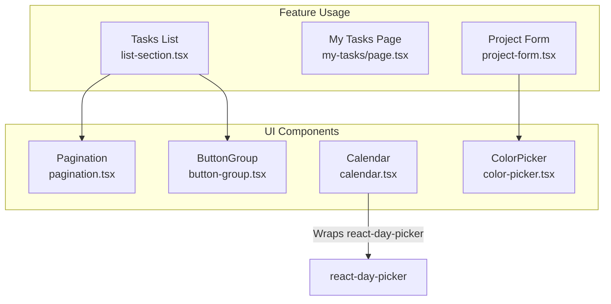
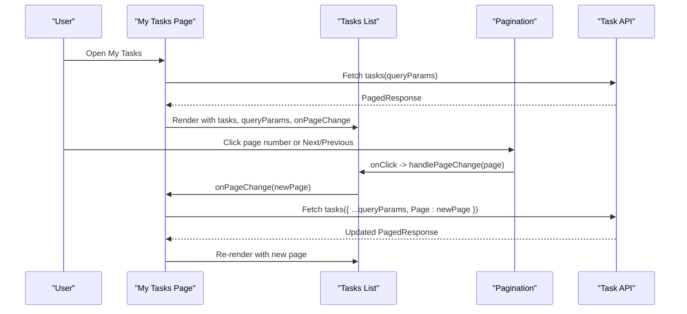
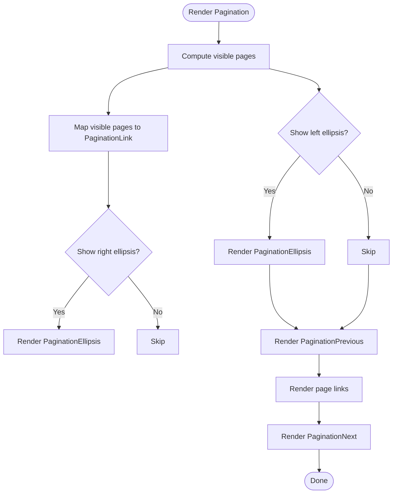
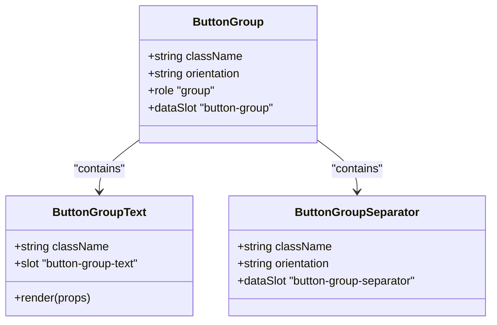
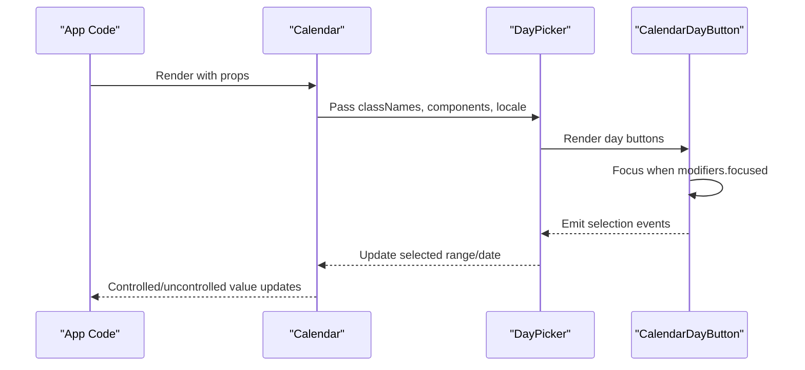
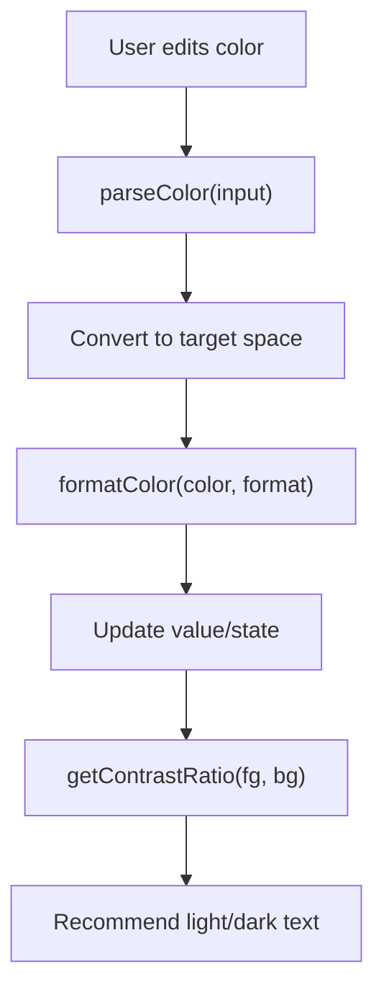
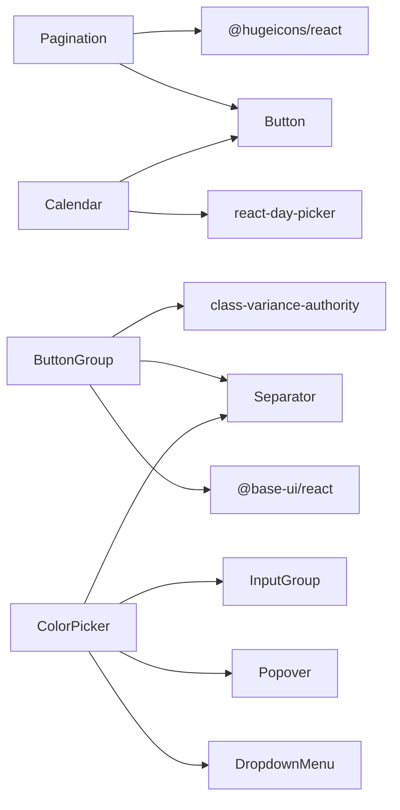

# Navigation Components

<cite>
**Referenced Files in This Document**
- [pagination.tsx](file://Apps/Web/src/components/ui/pagination.tsx)
- [button-group.tsx](file://Apps/Web/src/components/ui/button-group.tsx)
- [calendar.tsx](file://Apps/Web/src/components/ui/calendar.tsx)
- [color-picker.tsx](file://Apps/Web/src/components/ui/color-picker.tsx)
- [list-section.tsx](file://Apps/Web/src/components/tasks-page/list-section.tsx)
- [my-tasks page.tsx](file://Apps/Web/src/app/(protected)/my-tasks/page.tsx)
- [project-form.tsx](file://Apps/Web/src/components/projects-page/project-form.tsx)
</cite>

## Table of Contents
1. [Introduction](#introduction)
2. [Project Structure](#project-structure)
3. [Core Components](#core-components)
4. [Architecture Overview](#architecture-overview)
5. [Detailed Component Analysis](#detailed-component-analysis)
6. [Dependency Analysis](#dependency-analysis)
7. [Performance Considerations](#performance-considerations)
8. [Troubleshooting Guide](#troubleshooting-guide)
9. [Conclusion](#conclusion)

## Introduction
This document explains the navigation and specialized UI components used across the application: Pagination, ButtonGroup, Calendar, and ColorPicker. It covers component APIs, event handling, integration patterns, keyboard and touch support, cross-platform considerations, and performance guidance for complex interactions and large datasets. Examples are drawn from real usage in the codebase to show how these components fit into paginated interfaces, grouped controls, date selection workflows, and color selection functionality.

## Project Structure
The relevant components live under `Apps/Web/src/components/ui/`. They are consumed by feature pages and forms:
- Pagination is used inside a task list view to navigate between pages.
- ButtonGroup wraps inputs and selects to create cohesive control groups.
- Calendar is a styled wrapper around a third-party day picker library.
- ColorPicker is integrated into project creation/editing dialogs.

**Diagram sources**
- [pagination.tsx:1-131](file://Apps/Web/src/components/ui/pagination.tsx#L1-L131)
- [button-group.tsx:1-88](file://Apps/Web/src/components/ui/button-group.tsx#L1-L88)
- [calendar.tsx:1-223](file://Apps/Web/src/components/ui/calendar.tsx#L1-L223)
- [color-picker.tsx:1-800](file://Apps/Web/src/components/ui/color-picker.tsx#L1-L800)
- [list-section.tsx:49-57](file://Apps/Web/src/components/tasks-page/list-section.tsx#L49-L57)
- [list-section.tsx:320-453](file://Apps/Web/src/components/tasks-page/list-section.tsx#L320-L453)
- [project-form.tsx:146-153](file://Apps/Web/src/components/projects-page/project-form.tsx#L146-L153)

**Section sources**
- [pagination.tsx:1-131](file://Apps/Web/src/components/ui/pagination.tsx#L1-L131)
- [button-group.tsx:1-88](file://Apps/Web/src/components/ui/button-group.tsx#L1-L88)
- [calendar.tsx:1-223](file://Apps/Web/src/components/ui/calendar.tsx#L1-L223)
- [color-picker.tsx:1-800](file://Apps/Web/src/components/ui/color-picker.tsx#L1-L800)
- [list-section.tsx:49-57](file://Apps/Web/src/components/tasks-page/list-section.tsx#L49-L57)
- [list-section.tsx:320-453](file://Apps/Web/src/components/tasks-page/list-section.tsx#L320-L453)
- [project-form.tsx:146-153](file://Apps/Web/src/components/projects-page/project-form.tsx#L146-L153)

## Core Components
- Pagination: A composable set of elements that render accessible pagination controls using a shared button primitive.
- ButtonGroup: A layout container that visually merges adjacent controls (buttons, inputs, selects) with orientation variants.
- Calendar: A styled wrapper around a day picker library, providing consistent styling, custom chevron icons, and focused state management.
- ColorPicker: A comprehensive color selection tool supporting multiple formats, spaces, swatches, and accessibility features.

Key responsibilities:
- Provide accessible markup and ARIA attributes.
- Support keyboard navigation and focus management.
- Offer flexible composition through props and slots.
- Integrate cleanly with existing form and data flows.

**Section sources**
- [pagination.tsx:8-18](file://Apps/Web/src/components/ui/pagination.tsx#L8-L18)
- [button-group.tsx:25-39](file://Apps/Web/src/components/ui/button-group.tsx#L25-L39)
- [calendar.tsx:16-28](file://Apps/Web/src/components/ui/calendar.tsx#L16-L28)
- [color-picker.tsx:53-118](file://Apps/Web/src/components/ui/color-picker.tsx#L53-L118)

## Architecture Overview
The components follow a layered approach:
- Presentation layer: UI primitives (Button, Separator, Input, Select).
- Composition layer: Pagination, ButtonGroup, Calendar, ColorPicker.
- Feature layer: Task list, My Tasks page, Project form.

**Diagram sources**
- [my-tasks page.tsx:68-81](file://Apps/Web/src/app/(protected)/my-tasks/page.tsx#L68-L81)
- [my-tasks page.tsx:127-130](file://Apps/Web/src/app/(protected)/my-tasks/page.tsx#L127-L130)
- [list-section.tsx:457-549](file://Apps/Web/src/components/tasks-page/list-section.tsx#L457-L549)

## Detailed Component Analysis

### Pagination
Purpose:
- Render accessible pagination controls with previous/next links, numbered page links, and ellipsis indicators.
- Delegate visual rendering to a shared Button component while preserving link semantics.

API highlights:
- Pagination: root nav element with role="navigation" and aria-label="pagination".
- PaginationContent: unordered list container for items.
- PaginationItem: list item wrapper.
- PaginationLink: anchor rendered via Button; supports isActive and size; sets aria-current when active.
- PaginationPrevious/PaginationNext: navigational links with text and icon; hide text on small screens.
- PaginationEllipsis: decorative indicator with screen-reader-only label.

Integration example:
- The task list computes visible pages and renders PaginationPrevious, PaginationEllipsis, PaginationLink, and PaginationNext.
- Click handlers prevent default navigation and call an onPageChange callback to update query parameters.

Keyboard and accessibility:
- Uses native anchor elements for semantic navigation.
- aria-current marks the active page.
- Previous/Next have descriptive aria-labels.

Touch and responsiveness:
- Text labels for Previous/Next are hidden on small screens; icons remain visible.

**Diagram sources**
- [list-section.tsx:457-549](file://Apps/Web/src/components/tasks-page/list-section.tsx#L457-L549)
- [pagination.tsx:37-64](file://Apps/Web/src/components/ui/pagination.tsx#L37-L64)

**Section sources**
- [pagination.tsx:8-18](file://Apps/Web/src/components/ui/pagination.tsx#L8-L18)
- [pagination.tsx:20-35](file://Apps/Web/src/components/ui/pagination.tsx#L20-L35)
- [pagination.tsx:37-64](file://Apps/Web/src/components/ui/pagination.tsx#L37-L64)
- [pagination.tsx:66-120](file://Apps/Web/src/components/ui/pagination.tsx#L66-L120)
- [list-section.tsx:457-549](file://Apps/Web/src/components/tasks-page/list-section.tsx#L457-L549)

### ButtonGroup
Purpose:
- Visually group related controls such as inputs, buttons, and selects.
- Provide horizontal and vertical orientations with automatic border merging and spacing.

API highlights:
- ButtonGroup: container with role="group", data-slot, and orientation variant.
- ButtonGroupText: labeled display area with consistent styling.
- ButtonGroupSeparator: separator aligned to orientation.

Styling behavior:
- Uses class-variance-authority to apply merged borders and gaps based on sibling relationships.
- Integrates with other UI components via data-slot selectors.

Usage example:
- Wraps search input + search button.
- Wraps select controls for status, priority, and sort fields.

Accessibility:
- Provides a grouping context for assistive technologies.

**Diagram sources**
- [button-group.tsx:8-23](file://Apps/Web/src/components/ui/button-group.tsx#L8-L23)
- [button-group.tsx:25-39](file://Apps/Web/src/components/ui/button-group.tsx#L25-L39)
- [button-group.tsx:41-62](file://Apps/Web/src/components/ui/button-group.tsx#L41-L62)
- [button-group.tsx:64-80](file://Apps/Web/src/components/ui/button-group.tsx#L64-L80)

**Section sources**
- [button-group.tsx:8-23](file://Apps/Web/src/components/ui/button-group.tsx#L8-L23)
- [button-group.tsx:25-39](file://Apps/Web/src/components/ui/button-group.tsx#L25-L39)
- [button-group.tsx:41-62](file://Apps/Web/src/components/ui/button-group.tsx#L41-L62)
- [button-group.tsx:64-80](file://Apps/Web/src/components/ui/button-group.tsx#L64-L80)
- [list-section.tsx:320-453](file://Apps/Web/src/components/tasks-page/list-section.tsx#L320-L453)

### Calendar
Purpose:
- Provide a consistent, themed calendar interface built on top of react-day-picker.
- Customize chevrons, day buttons, and caption layout.

API highlights:
- Calendar: accepts DayPicker props plus buttonVariant, locale, formatters, classNames, and components overrides.
- CalendarDayButton: custom button for each day with focus management and data attributes for selected/range states.

Integration notes:
- Applies default class names from react-day-picker and merges with Tailwind classes.
- Supports RTL rotation for chevrons.
- Focuses the active day when modifiers.focused changes.

Accessibility:
- Leverages underlying DayPicker accessibility features.
- Custom day button ensures focus ring and aria states are applied consistently.

**Diagram sources**
- [calendar.tsx:16-28](file://Apps/Web/src/components/ui/calendar.tsx#L16-L28)
- [calendar.tsx:137-178](file://Apps/Web/src/components/ui/calendar.tsx#L137-L178)
- [calendar.tsx:184-220](file://Apps/Web/src/components/ui/calendar.tsx#L184-L220)

**Section sources**
- [calendar.tsx:16-28](file://Apps/Web/src/components/ui/calendar.tsx#L16-L28)
- [calendar.tsx:29-136](file://Apps/Web/src/components/ui/calendar.tsx#L29-L136)
- [calendar.tsx:137-178](file://Apps/Web/src/components/ui/calendar.tsx#L137-L178)
- [calendar.tsx:184-220](file://Apps/Web/src/components/ui/calendar.tsx#L184-L220)

### ColorPicker
Purpose:
- Provide a rich color selection experience with multiple formats (HEX, RGB, HSL, HSB, OKLCH), color spaces, sliders, swatches, and copy-to-clipboard.

API highlights:
- Types: ColorPickerFormat, ColorPickerColorSpace, ColorPickerChannel, ColorPickerColor, i18n labels/functions.
- Utilities: parseColor, formatColor, getContrastRatio, isColorInSrgb.
- Integration: Used as a controlled component with id, value, and onValueChange.

Behavioral characteristics:
- Parses CSS color strings and named colors.
- Converts between color spaces and handles alpha channels.
- Provides contrast calculation and text color recommendation utilities.

Usage example:
- In the project form dialog, ColorPicker is bound to a local state field and updated via onValueChange.

Accessibility:
- Includes labels for panel, area, sliders, and swatches.
- Offers copy feedback and clear actions.

**Diagram sources**
- [color-picker.tsx:642-690](file://Apps/Web/src/components/ui/color-picker.tsx#L642-L690)
- [color-picker.tsx:727-753](file://Apps/Web/src/components/ui/color-picker.tsx#L727-L753)
- [color-picker.tsx:777-790](file://Apps/Web/src/components/ui/color-picker.tsx#L777-L790)

**Section sources**
- [color-picker.tsx:53-118](file://Apps/Web/src/components/ui/color-picker.tsx#L53-L118)
- [color-picker.tsx:642-690](file://Apps/Web/src/components/ui/color-picker.tsx#L642-L690)
- [color-picker.tsx:727-753](file://Apps/Web/src/components/ui/color-picker.tsx#L727-L753)
- [color-picker.tsx:777-790](file://Apps/Web/src/components/ui/color-picker.tsx#L777-L790)
- [project-form.tsx:146-153](file://Apps/Web/src/components/projects-page/project-form.tsx#L146-L153)

## Dependency Analysis
Component-level dependencies:
- Pagination depends on Button and icon libraries.
- ButtonGroup depends on Base UI merge/render utilities, class-variance-authority, and Separator.
- Calendar depends on react-day-picker and Button.
- ColorPicker depends on DropdownMenu, Popover, InputGroup, Separator, and icon libraries.

Cross-cutting concerns:
- All components use cn for class merging.
- Icons are provided via Hugeicons.

**Diagram sources**
- [pagination.tsx:1-6](file://Apps/Web/src/components/ui/pagination.tsx#L1-L6)
- [button-group.tsx:1-6](file://Apps/Web/src/components/ui/button-group.tsx#L1-L6)
- [calendar.tsx:1-14](file://Apps/Web/src/components/ui/calendar.tsx#L1-L14)
- [color-picker.tsx:23-47](file://Apps/Web/src/components/ui/color-picker.tsx#L23-L47)

**Section sources**
- [pagination.tsx:1-6](file://Apps/Web/src/components/ui/pagination.tsx#L1-L6)
- [button-group.tsx:1-6](file://Apps/Web/src/components/ui/button-group.tsx#L1-L6)
- [calendar.tsx:1-14](file://Apps/Web/src/components/ui/calendar.tsx#L1-L14)
- [color-picker.tsx:23-47](file://Apps/Web/src/components/ui/color-picker.tsx#L23-L47)

## Performance Considerations
- Pagination:
  - Keep visible page count small; compute only necessary slices.
  - Avoid re-renders by memoizing computed page arrays if needed.
  - Debounce any side effects triggered by page changes at the page level.

- ButtonGroup:
  - Prefer stable child components to avoid unnecessary style recalculations.
  - Use orientation variants judiciously; excessive nesting can increase selector complexity.

- Calendar:
  - Limit re-renders by passing stable classNames and components objects.
  - Avoid heavy computations in formatters; precompute where possible.

- ColorPicker:
  - Defer expensive conversions until user input stabilizes.
  - Use controlled mode sparingly; consider uncontrolled with ref-based reads for high-frequency updates.
  - Memoize derived values like contrast ratios when recomputing frequently.

General guidelines:
- Batch state updates and avoid tight loops in event handlers.
- Use React.memo for pure presentational wrappers.
- Offload heavy math to Web Workers if color calculations become a bottleneck.

[No sources needed since this section provides general guidance]

## Troubleshooting Guide
Common issues and resolutions:
- Pagination not updating:
  - Ensure onClick handlers call the parent onPageChange and do not trigger full page reloads.
  - Validate bounds against totalPages before updating state.

- ButtonGroup misalignment:
  - Verify children use compatible components with data-slot attributes.
  - Check orientation prop and ensure nested groups do not conflict with sibling styles.

- Calendar focus not moving:
  - Confirm modifiers.focused is managed correctly.
  - Ensure custom DayButton forwards focus refs and respects focus state.

- ColorPicker parsing errors:
  - Validate input strings with parseColor before setting state.
  - Handle unsupported formats gracefully and provide fallbacks.

- Accessibility warnings:
  - Add aria-labels to interactive elements where missing.
  - Ensure proper roles and aria-current for active states.

**Section sources**
- [list-section.tsx:486-489](file://Apps/Web/src/components/tasks-page/list-section.tsx#L486-L489)
- [button-group.tsx:8-23](file://Apps/Web/src/components/ui/button-group.tsx#L8-L23)
- [calendar.tsx:193-196](file://Apps/Web/src/components/ui/calendar.tsx#L193-L196)
- [color-picker.tsx:642-690](file://Apps/Web/src/components/ui/color-picker.tsx#L642-L690)

## Conclusion
Pagination, ButtonGroup, Calendar, and ColorPicker provide robust, accessible, and customizable building blocks for navigation and specialized UI interactions. By composing them thoughtfully and following the integration patterns shown here, you can implement efficient paginated interfaces, cohesive grouped controls, reliable date selection workflows, and comprehensive color selection experiences. Pay attention to keyboard and touch behaviors, maintain accessibility attributes, and optimize performance for complex scenarios to deliver a smooth user experience across platforms.

[No sources needed since this section summarizes without analyzing specific files]