# UI Components

<cite>
**Referenced Files in This Document**
- [button.tsx](file://Apps/Web/src/components/ui/button.tsx)
- [input.tsx](file://Apps/Web/src/components/ui/input.tsx)
- [card.tsx](file://Apps/Web/src/components/ui/card.tsx)
- [dialog.tsx](file://Apps/Web/src/components/ui/dialog.tsx)
- [select.tsx](file://Apps/Web/src/components/ui/select.tsx)
- [tabs.tsx](file://Apps/Web/src/components/ui/tabs.tsx)
- [table.tsx](file://Apps/Web/src/components/ui/table.tsx)
- [toast.tsx](file://Apps/Web/src/components/ui/toast.tsx)
- [badge.tsx](file://Apps/Web/src/components/ui/badge.tsx)
- [avatar.tsx](file://Apps/Web/src/components/ui/avatar.tsx)
- [separator.tsx](file://Apps/Web/src/components/ui/separator.tsx)
- [popover.tsx](file://Apps/Web/src/components/ui/popover.tsx)
- [tooltip.tsx](file://Apps/Web/src/components/ui/tooltip.tsx)
- [collapsible.tsx](file://Apps/Web/src/components/ui/collapsible.tsx)
- [pagination.tsx](file://Apps/Web/src/components/ui/pagination.tsx)
- [skeleton.tsx](file://Apps/Web/src/components/ui/skeleton.tsx)
</cite>

## Table of Contents
1. Introduction
2. Project Structure
3. Core Components
4. Architecture Overview
5. Detailed Component Analysis
6. Dependency Analysis
7. Performance Considerations
8. Troubleshooting Guide
9. Conclusion

## Introduction
This document describes the reusable UI component library built on top of shadcn/ui primitives and Base UI, with custom styling via Tailwind CSS and class-variance-authority. The components emphasize accessibility, responsive design, and consistent theming through CSS variables and semantic data attributes. Each component exposes a minimal, composable API that aligns with common React patterns while providing sensible defaults for appearance and behavior.

## Project Structure
The UI components live under src/components/ui and are organized by feature (Button, Input, Dialog, Select, Tabs, Table, Toast, Badge, Avatar, Separator, Popover, Tooltip, Collapsible, Pagination, Skeleton). They share common utilities:
- cn utility for conditional class composition
- Base UI primitives for unstyled, accessible behavior
- Hugeicons for icons used across components
- Tailwind CSS for layout, spacing, colors, and responsive rules

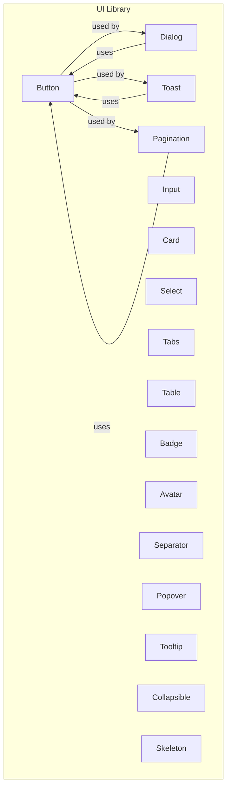

**Diagram sources**
- [button.tsx:1-58](file://Apps/Web/src/components/ui/button.tsx#L1-L58)
- [dialog.tsx:1-140](file://Apps/Web/src/components/ui/dialog.tsx#L1-L140)
- [toast.tsx:1-236](file://Apps/Web/src/components/ui/toast.tsx#L1-L236)
- [pagination.tsx:1-131](file://Apps/Web/src/components/ui/pagination.tsx#L1-L131)

**Section sources**
- [button.tsx:1-58](file://Apps/Web/src/components/ui/button.tsx#L1-L58)
- [dialog.tsx:1-140](file://Apps/Web/src/components/ui/dialog.tsx#L1-L140)
- [toast.tsx:1-236](file://Apps/Web/src/components/ui/toast.tsx#L1-L236)
- [pagination.tsx:1-131](file://Apps/Web/src/components/ui/pagination.tsx#L1-L131)

## Core Components
This section summarizes the core components, their props, events, slots, and customization options. All components use Tailwind classes and data-slot attributes to enable consistent styling and testing hooks.

- Button
  - Props: variant (default, outline, secondary, ghost, destructive, link), size (default, xs, sm, lg, icon, icon-xs, icon-sm, icon-lg), plus all base button props
  - Events: standard button events; supports nativeButton prop via Base UI when needed
  - Slots: inline-start/inline-end icons via data-icon attributes
  - Theming: uses CSS variables for colors and ring states; supports dark mode via Tailwind dark variants
  - Accessibility: focus-visible rings, aria-invalid support, keyboard interaction via Base UI

- Input
  - Props: type, className, plus all native input props
  - Slots: file input handled with consistent styling
  - Theming: transparent background, focus rings, disabled state, dark mode
  - Accessibility: proper focus management and invalid states

- Card
  - Props: size (default, sm)
  - Subcomponents: CardHeader, CardTitle, CardDescription, CardAction, CardContent, CardFooter
  - Theming: CSS variable spacing (--card-spacing), responsive image border radius
  - Accessibility: semantic grouping via data-slot attributes

- Dialog
  - Props: showCloseButton on content/footer
  - Subcomponents: Trigger, Portal, Close, Overlay, Content, Header, Footer, Title, Description
  - Behavior: portal rendering, backdrop, animations, close button integration
  - Accessibility: focus trap, ARIA roles provided by Base UI

- Select
  - Props: size (sm, default) on trigger; positioning props on content
  - Subcomponents: Group, Value, Trigger, Content, Label, Item, Separator, ScrollUp/Down buttons
  - Theming: placeholder text, focus rings, dark mode, scroll indicators
  - Accessibility: keyboard navigation, item selection indicator

- Tabs
  - Props: orientation (horizontal, vertical)
  - Subcomponents: List, Trigger, Content
  - Variants: default, line
  - Accessibility: keyboard switching, active state styles

- Table
  - Subcomponents: Table, TableHeader, TableBody, TableFooter, TableRow, TableHead, TableCell, TableCaption
  - Theming: hover states, selected row, footer background
  - Accessibility: semantic table structure

- Toast
  - Props: type (success, info, warning, error, loading) via ToastIcon mapping
  - Subcomponents: Provider, Portal, Viewport, Root, Content, Title, Description, Action, Close, Toaster
  - Behavior: stacking, swipe gestures, animations, z-index layering
  - Accessibility: aria-labels, screen-reader friendly messages

- Badge
  - Props: variant (default, secondary, destructive, outline, ghost, link)
  - Rendering: span or custom render via Base UI useRender
  - Theming: color variants, hover states

- Avatar
  - Props: size (default, sm, lg)
  - Subcomponents: Image, Fallback, Badge, Group, GroupCount
  - Theming: ring, blend modes, responsive sizes

- Separator
  - Props: orientation (horizontal, vertical)
  - Theming: border-like lines using bg-border

- Popover
  - Subcomponents: Root, Trigger, Content, Header, Title, Description
  - Behavior: portal, positioner, animations

- Tooltip
  - Subcomponents: Provider, Root, Trigger, Content
  - Behavior: delay, arrow, positioning

- Collapsible
  - Subcomponents: Root, Trigger, Panel
  - Behavior: toggle panel visibility

- Pagination
  - Subcomponents: Content, Item, Link, Previous, Next, Ellipsis
  - Props: isActive on Link, size inherited from Button
  - Accessibility: aria-labels, current page indication

- Skeleton
  - Props: className
  - Theming: pulse animation, muted background

**Section sources**
- [button.tsx:1-58](file://Apps/Web/src/components/ui/button.tsx#L1-L58)
- [input.tsx:1-20](file://Apps/Web/src/components/ui/input.tsx#L1-L20)
- [card.tsx:1-88](file://Apps/Web/src/components/ui/card.tsx#L1-L88)
- [dialog.tsx:1-140](file://Apps/Web/src/components/ui/dialog.tsx#L1-L140)
- [select.tsx:1-200](file://Apps/Web/src/components/ui/select.tsx#L1-L200)
- [tabs.tsx:1-82](file://Apps/Web/src/components/ui/tabs.tsx#L1-L82)
- [table.tsx:1-89](file://Apps/Web/src/components/ui/table.tsx#L1-L89)
- [toast.tsx:1-236](file://Apps/Web/src/components/ui/toast.tsx#L1-L236)
- [badge.tsx:1-49](file://Apps/Web/src/components/ui/badge.tsx#L1-L49)
- [avatar.tsx:1-93](file://Apps/Web/src/components/ui/avatar.tsx#L1-L93)
- [separator.tsx:1-21](file://Apps/Web/src/components/ui/separator.tsx#L1-L21)
- [popover.tsx:1-90](file://Apps/Web/src/components/ui/popover.tsx#L1-L90)
- [tooltip.tsx:1-54](file://Apps/Web/src/components/ui/tooltip.tsx#L1-L54)
- [collapsible.tsx:1-18](file://Apps/Web/src/components/ui/collapsible.tsx#L1-L18)
- [pagination.tsx:1-131](file://Apps/Web/src/components/ui/pagination.tsx#L1-L131)
- [skeleton.tsx:1-14](file://Apps/Web/src/components/ui/skeleton.tsx#L1-L14)

## Architecture Overview
The UI library follows a layered architecture:
- Base UI primitives provide unstyled, accessible behaviors (dialogs, selects, popovers, tooltips, etc.)
- Custom wrappers add Tailwind-based styling, variants, and consistent data-slot attributes
- Shared utilities (cn) merge class names efficiently
- Icons come from Hugeicons and are integrated into triggers and indicators

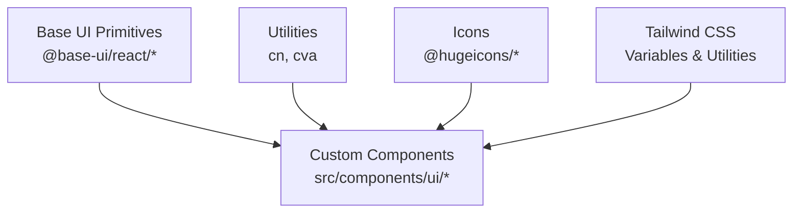

**Diagram sources**
- [button.tsx:1-58](file://Apps/Web/src/components/ui/button.tsx#L1-L58)
- [dialog.tsx:1-140](file://Apps/Web/src/components/ui/dialog.tsx#L1-L140)
- [select.tsx:1-200](file://Apps/Web/src/components/ui/select.tsx#L1-L200)
- [toast.tsx:1-236](file://Apps/Web/src/components/ui/toast.tsx#L1-L236)

## Detailed Component Analysis

### Button
- Purpose: Primary interactive element with multiple visual variants and sizes
- Props: variant, size, className, plus Base UI button props
- Styling: class-variance-authority defines variants and sizes; Tailwind handles transitions, focus rings, and dark mode
- Accessibility: focus-visible outlines, aria-invalid states, keyboard support
- Composition: supports inline icons via data-icon attributes

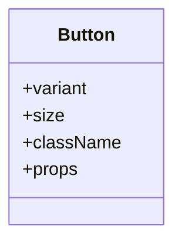

**Diagram sources**
- [button.tsx:1-58](file://Apps/Web/src/components/ui/button.tsx#L1-L58)

**Section sources**
- [button.tsx:1-58](file://Apps/Web/src/components/ui/button.tsx#L1-L58)

### Dialog
- Purpose: Accessible modal dialog with overlay, portal, and optional close button
- Props: showCloseButton on content and footer
- Subcomponents: Trigger, Portal, Close, Overlay, Content, Header, Footer, Title, Description
- Behavior: portal rendering, backdrop blur, entrance/exit animations
- Accessibility: focus trap, ARIA roles, keyboard dismissal

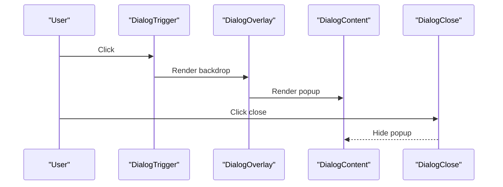

**Diagram sources**
- [dialog.tsx:1-140](file://Apps/Web/src/components/ui/dialog.tsx#L1-L140)

**Section sources**
- [dialog.tsx:1-140](file://Apps/Web/src/components/ui/dialog.tsx#L1-L140)

### Select
- Purpose: Accessible dropdown select with grouped items and scrolling
- Props: size on trigger; positioning props on content
- Subcomponents: Group, Value, Trigger, Content, Label, Item, Separator, ScrollUp/Down
- Behavior: portal, positioner, slide-in animations, item indicator
- Accessibility: keyboard navigation, focus management, item selection indicator

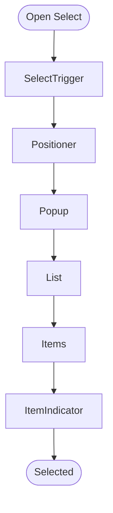

**Diagram sources**
- [select.tsx:1-200](file://Apps/Web/src/components/ui/select.tsx#L1-L200)

**Section sources**
- [select.tsx:1-200](file://Apps/Web/src/components/ui/select.tsx#L1-L200)

### Tabs
- Purpose: Tabbed interface supporting horizontal and vertical orientations
- Props: orientation
- Subcomponents: List, Trigger, Content
- Variants: default, line
- Accessibility: keyboard switching, active state styles

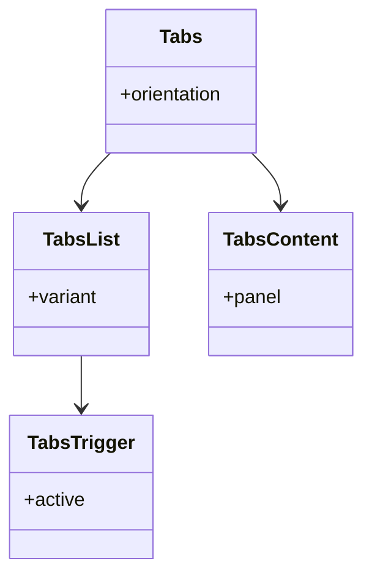

**Diagram sources**
- [tabs.tsx:1-82](file://Apps/Web/src/components/ui/tabs.tsx#L1-L82)

**Section sources**
- [tabs.tsx:1-82](file://Apps/Web/src/components/ui/tabs.tsx#L1-L82)

### Table
- Purpose: Semantic table with header, body, footer, rows, cells, and caption
- Subcomponents: Table, TableHeader, TableBody, TableFooter, TableRow, TableHead, TableCell, TableCaption
- Styling: hover states, selected row, footer background
- Accessibility: semantic HTML structure

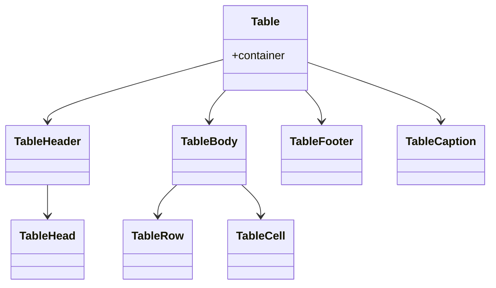

**Diagram sources**
- [table.tsx:1-89](file://Apps/Web/src/components/ui/table.tsx#L1-L89)

**Section sources**
- [table.tsx:1-89](file://Apps/Web/src/components/ui/table.tsx#L1-L89)

### Toast
- Purpose: Non-blocking notifications with stacking, swipe gestures, and animated exits
- Subcomponents: Provider, Portal, Viewport, Root, Content, Title, Description, Action, Close, Toaster
- Behavior: manager instance, viewport stacking, swipe directions, z-index layering
- Accessibility: aria-labels, screen-reader friendly descriptions

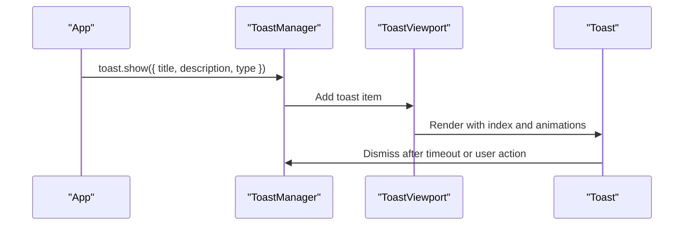

**Diagram sources**
- [toast.tsx:1-236](file://Apps/Web/src/components/ui/toast.tsx#L1-L236)

**Section sources**
- [toast.tsx:1-236](file://Apps/Web/src/components/ui/toast.tsx#L1-L236)

### Badge
- Purpose: Small status or label indicator with multiple variants
- Props: variant, className, render
- Styling: color variants, hover states, focus rings
- Accessibility: semantic span or custom render

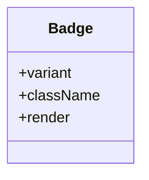

**Diagram sources**
- [badge.tsx:1-49](file://Apps/Web/src/components/ui/badge.tsx#L1-L49)

**Section sources**
- [badge.tsx:1-49](file://Apps/Web/src/components/ui/badge.tsx#L1-L49)

### Avatar
- Purpose: User avatar with fallback, badge, and group layouts
- Props: size (default, sm, lg)
- Subcomponents: Image, Fallback, Badge, Group, GroupCount
- Styling: ring, blend modes, responsive sizes
- Accessibility: semantic grouping

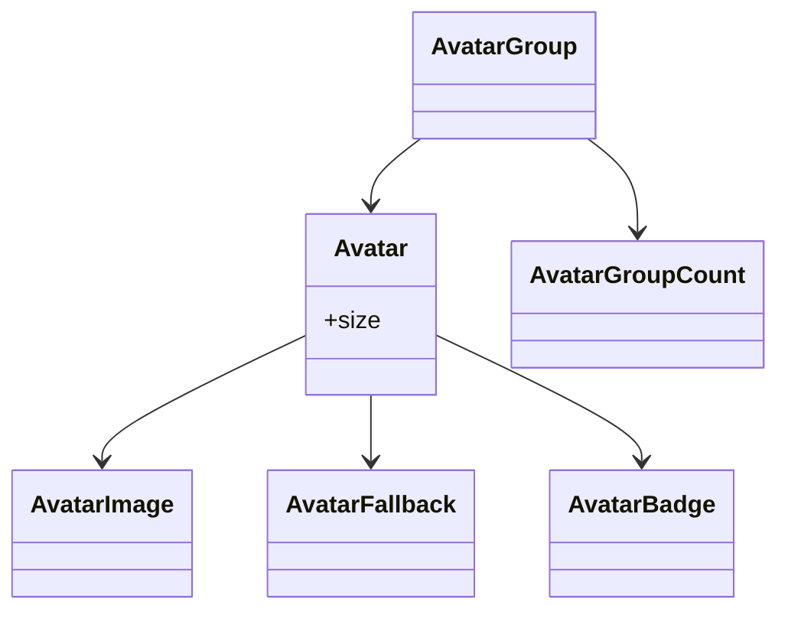

**Diagram sources**
- [avatar.tsx:1-93](file://Apps/Web/src/components/ui/avatar.tsx#L1-L93)

**Section sources**
- [avatar.tsx:1-93](file://Apps/Web/src/components/ui/avatar.tsx#L1-L93)

### Separator
- Purpose: Visual divider with horizontal or vertical orientation
- Props: orientation
- Styling: border-like lines using bg-border

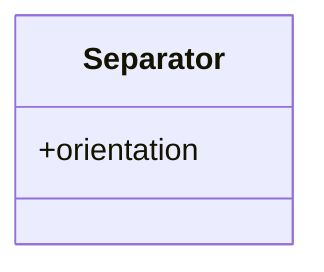

**Diagram sources**
- [separator.tsx:1-21](file://Apps/Web/src/components/ui/separator.tsx#L1-L21)

**Section sources**
- [separator.tsx:1-21](file://Apps/Web/src/components/ui/separator.tsx#L1-L21)

### Popover
- Purpose: Floating content anchored to a trigger
- Subcomponents: Root, Trigger, Content, Header, Title, Description
- Behavior: portal, positioner, animations

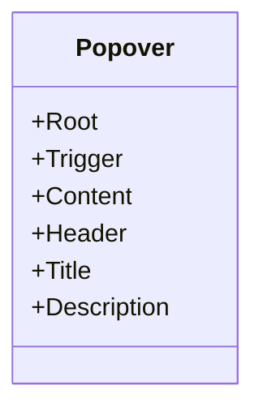

**Diagram sources**
- [popover.tsx:1-90](file://Apps/Web/src/components/ui/popover.tsx#L1-L90)

**Section sources**
- [popover.tsx:1-90](file://Apps/Web/src/components/ui/popover.tsx#L1-L90)

### Tooltip
- Purpose: Contextual hint displayed near a trigger
- Subcomponents: Provider, Root, Trigger, Content
- Behavior: delay, arrow, positioning

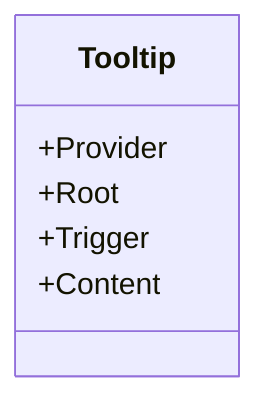

**Diagram sources**
- [tooltip.tsx:1-54](file://Apps/Web/src/components/ui/tooltip.tsx#L1-L54)

**Section sources**
- [tooltip.tsx:1-54](file://Apps/Web/src/components/ui/tooltip.tsx#L1-L54)

### Collapsible
- Purpose: Toggleable content panel
- Subcomponents: Root, Trigger, Panel
- Behavior: expand/collapse state managed by Base UI

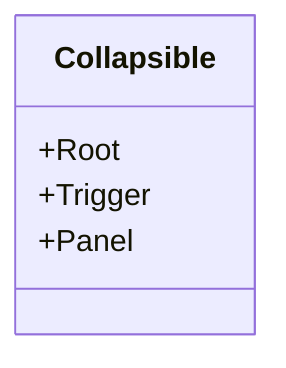

**Diagram sources**
- [collapsible.tsx:1-18](file://Apps/Web/src/components/ui/collapsible.tsx#L1-L18)

**Section sources**
- [collapsible.tsx:1-18](file://Apps/Web/src/components/ui/collapsible.tsx#L1-L18)

### Pagination
- Purpose: Navigational control for paginated content
- Subcomponents: Content, Item, Link, Previous, Next, Ellipsis
- Props: isActive on Link, size inherited from Button
- Accessibility: aria-labels, current page indication

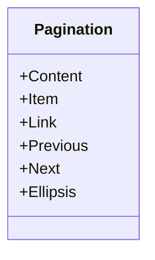

**Diagram sources**
- [pagination.tsx:1-131](file://Apps/Web/src/components/ui/pagination.tsx#L1-L131)

**Section sources**
- [pagination.tsx:1-131](file://Apps/Web/src/components/ui/pagination.tsx#L1-L131)

### Skeleton
- Purpose: Placeholder for loading states
- Props: className
- Styling: pulse animation, muted background

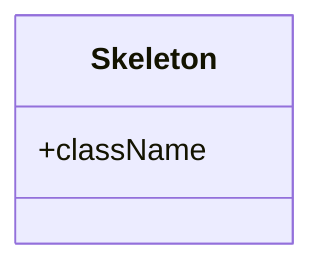

**Diagram sources**
- [skeleton.tsx:1-14](file://Apps/Web/src/components/ui/skeleton.tsx#L1-L14)

**Section sources**
- [skeleton.tsx:1-14](file://Apps/Web/src/components/ui/skeleton.tsx#L1-L14)

## Dependency Analysis
Components depend on:
- Base UI primitives for behavior and accessibility
- Hugeicons for consistent iconography
- Tailwind CSS for styling and responsive design
- class-variance-authority for variant-driven styling
- cn utility for efficient class merging

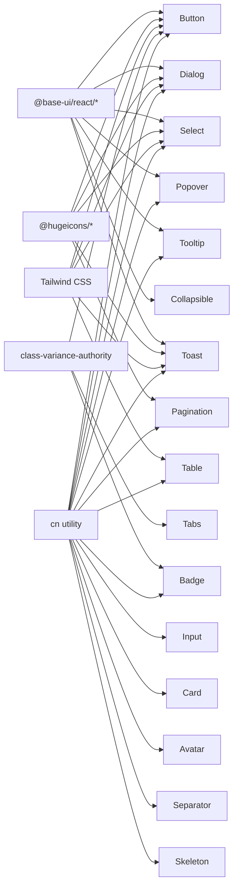

**Diagram sources**
- [button.tsx:1-58](file://Apps/Web/src/components/ui/button.tsx#L1-L58)
- [dialog.tsx:1-140](file://Apps/Web/src/components/ui/dialog.tsx#L1-L140)
- [select.tsx:1-200](file://Apps/Web/src/components/ui/select.tsx#L1-L200)
- [table.tsx:1-89](file://Apps/Web/src/components/ui/table.tsx#L1-L89)
- [toast.tsx:1-236](file://Apps/Web/src/components/ui/toast.tsx#L1-L236)
- [pagination.tsx:1-131](file://Apps/Web/src/components/ui/pagination.tsx#L1-L131)

**Section sources**
- [button.tsx:1-58](file://Apps/Web/src/components/ui/button.tsx#L1-L58)
- [dialog.tsx:1-140](file://Apps/Web/src/components/ui/dialog.tsx#L1-L140)
- [select.tsx:1-200](file://Apps/Web/src/components/ui/select.tsx#L1-L200)
- [table.tsx:1-89](file://Apps/Web/src/components/ui/table.tsx#L1-L89)
- [toast.tsx:1-236](file://Apps/Web/src/components/ui/toast.tsx#L1-L236)
- [pagination.tsx:1-131](file://Apps/Web/src/components/ui/pagination.tsx#L1-L131)

## Performance Considerations
- Use data-slot attributes for stable selectors instead of heavy CSS selectors
- Prefer Tailwind utilities over custom CSS to leverage purging and minimize bundle size
- Avoid unnecessary re-renders by keeping component props minimal and stable
- Leverage Base UI’s optimized primitives for dialogs, selects, and popovers to reduce custom logic
- Use skeleton placeholders to improve perceived performance during data loading
- Keep icon usage minimal and reuse shared icon components where possible

[No sources needed since this section provides general guidance]

## Troubleshooting Guide
- Focus and ring issues: Ensure focus-visible styles are applied; verify that custom className does not override focus rings
- Invalid states: Confirm aria-invalid is set appropriately for form inputs and related components
- Dark mode: Verify Tailwind dark mode configuration and that components use dark: variants consistently
- Portal stacking: For overlays like Dialog and Toast, ensure correct z-index context and avoid conflicting global styles
- Icon sizing: When using inline icons, ensure size utilities are applied to prevent misalignment
- Responsive layout: Check container queries and responsive breakpoints; adjust spacing and typography as needed

**Section sources**
- [button.tsx:1-58](file://Apps/Web/src/components/ui/button.tsx#L1-L58)
- [input.tsx:1-20](file://Apps/Web/src/components/ui/input.tsx#L1-L20)
- [dialog.tsx:1-140](file://Apps/Web/src/components/ui/dialog.tsx#L1-L140)
- [toast.tsx:1-236](file://Apps/Web/src/components/ui/toast.tsx#L1-L236)

## Conclusion
The UI component library provides a cohesive, accessible, and customizable set of primitives built on Base UI and styled with Tailwind CSS. By leveraging variants, data-slot attributes, and CSS variables, it offers a flexible foundation for building responsive, theme-aware interfaces. Following the documented patterns ensures consistency, maintainability, and strong accessibility across the application.

[No sources needed since this section summarizes without analyzing specific files]